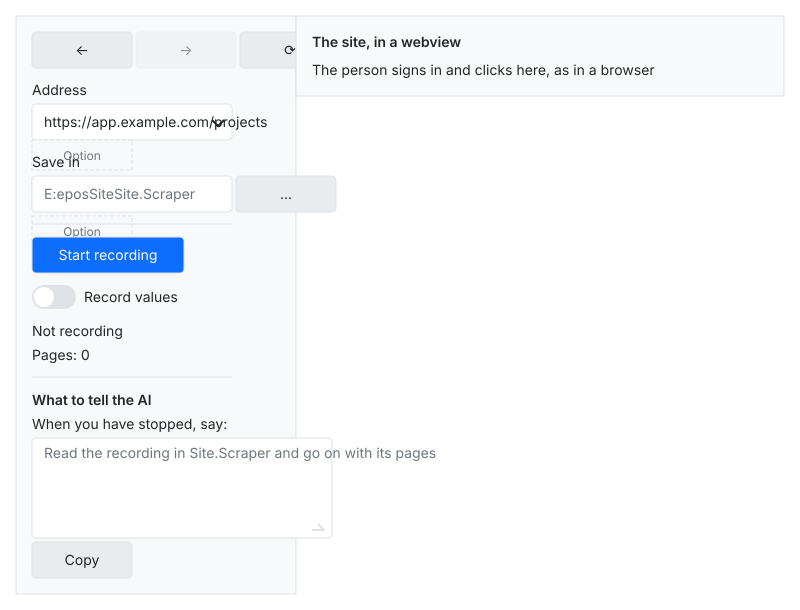

# Design: the recorder as an app with a webview

Status: **built on Windows, written for the Mac** (2026-11-24). The design below is as it was agreed; what was built
differently is in [As built](#10-as-built).

| | |
| --- | --- |
| What | The other shape of [the proposal](proposal.md): a small app of the Scraper's own that holds the site in a webview, with every control in a column on the left |
| What is the same | A person clicks, the Scraper records, the model never clicks. Sections 1, 4 and 6 of the proposal hold here unless this document says otherwise |
| Runs on | Windows and Mac: a MAUI app (section 3) |
| What it writes | A recording as the Scraper writes it today: `recording.json` and a `*.nodes.jsonl` per page, with one addition: an event per press (section 5) |
| What it reverses | AD-027 rules out "a Scraper window or app of its own" and "recording input values in a capture". Section 7 |

## 1. The window

```wireframe id=recorder
wireframe clean
    %title: Bruinet Recorder

    Horizontal gap=0
        Sidebar w=280 padding=12
            Vertical gap=12
                Horizontal gap=4
                    Button "←" :btnBack
                    Button "→" :btnForward disabled
                    Button "⟳" :btnReload
                    Button "⌂" :btnHome
                /Horizontal
                Vertical gap=4
                    Label "Address"
                    Dropdown :ddAddress
                        Option "https://app.example.com/projects" selected
                        Option "https://app.example.com/contacts"
                        Option "https://app.example.com/"
                    /Dropdown
                /Vertical
                Vertical gap=4
                    Label "Save in"
                    Horizontal gap=4
                        TextInput "E:\repos\Site\Site.Scraper" :txtFolder
                        Button "…" :btnBrowse
                    /Horizontal
                /Vertical
                Separator
                Button "Start recording" :btnRecord primary
                Switch "Record values" :swValues
                Vertical gap=4
                    Label "Not recording" :lblState
                    Label "Pages: 0" :lblPages
                /Vertical
                Separator
                Vertical gap=4
                    Label "**What to tell the AI**" :lblHelp
                    Label "When you have stopped, say:"
                    TextArea "Read the recording in Site.Scraper and go on with its pages" :txtPrompt readonly
                    Button "Copy" :btnCopy
                /Vertical
            /Vertical
        /Sidebar
        Content padding=16
            Vertical gap=8 align=center
                Label "**The site, in a webview**"
                Label "The person signs in and clicks here, as in a browser"
            /Vertical
        /Content
    /Horizontal
/wireframe
```



From the top of the column:

| Part | What it does |
| --- | --- |
| **Back, forward, reload, start** `btnBack` `btnForward` `btnReload` `btnHome` | Icons. What a browser's own do; start opens the project's `StartUrl`. A page reached with them while recording is recorded like any other |
| **Address** `ddAddress` | Where the webview is; it follows the page. Typing an address and Enter opens it. The list under it is the addresses opened from this field before, the last first (section 4) |
| **Save in** `txtFolder` | The app's Scraper project (the folder with `scraper.config.md`). Fixed while recording |
| **Start recording / Stop recording** `btnRecord` | One button that says what it will do. Disabled until the folder is a Scraper project and the address is on one of its `ExploreHosts` |
| **Record values** `swValues` | Off: no value of a field is read, as now. On: each captured page holds its fields' values as they are at that moment. Nothing else changes |
| **State** `lblState` `lblPages` | "Not recording", "Recording" or "Recording, with values", and the pages captured in this recording |
| **What to tell the AI** `txtPrompt` `btnCopy` | A sentence to paste into the chat, written for the state the app is in, with the folder's real name in it (section 6) |
| **The webview** | The site, in the rest of the window. Nothing is put into the page |

## 2. How the chat starts it

```powershell
# every argument is optional: the folder is the current one when left out, the rest comes from its settings file
bruinet scrape record --folder E:\repos\Site\Site.Scraper --url https://app.example.com/projects --as Admin
```

The window opens with the address and the folder filled in and **not recording**. An address passed this
way is added to the list like one a person typed.

## 3. MAUI, so it also runs on a Mac

Yes, it is possible, and it changes how the page is read.

| | Windows | Mac |
| --- | --- | --- |
| MAUI's `WebView` is | WebView2 (Edge's engine) | WKWebView (Safari's engine), in a Mac Catalyst app |
| A debugging connection for Playwright | There is one | There is none |

The first version of this design read the page through Playwright connected to WebView2. That cannot work
on a Mac, so the reader is built the other way, once, for both:

| Part | How | Why it works on both |
| --- | --- | --- |
| Reading a page | A new `IScrapeSource` in the app that runs the Scraper's own `capture.js` and `settle.js` in the webview and gives the engine the same `ScrapeSnapshot` | The capture already is a script in the page; Playwright only delivers it. `WebView.EvaluateJavaScriptAsync` delivers it as well |
| Knowing a step happened | A script added to each document tells the app of a click and of the page going still; the webview's own `Navigated` tells of a new address | Both webviews can add a script to every document, through the MAUI handler: a few lines of platform code each |
| Back, forward, reload | `WebView.GoBack`, `GoForward`, `Reload` | MAUI's own |
| The sign-in | The webview's own storage, per account, under the user's profile | The Scraper's saved Chromium sign-in is not used: the person signs in once in the app |
| The engine | `Bruinet.Scraper`, with no reference to MAUI; the app is `tools/Bruinet.Recorder` | AD-027's "Broken when `Bruinet.Scraper` references a UI framework" stays true |

What it costs, against Playwright:

| Lost or weaker | What it means | What to do |
| --- | --- | --- |
| **Writes cannot be held at the network** | Neither webview lets the app stop a request on both platforms. The proposal's "writes held by default" does not hold here: what the person presses, happens | Accept it: the person presses knowingly, which is the point of the tool. A script could refuse `fetch` and form posts in the page, but a page can get round that, so it would be a promise the app cannot keep |
| **The page's calls** | Seen only by wrapping `fetch` and `XMLHttpRequest` in the page: most calls, not all | Leave them out of the first version. The existing recording format holds no calls anyway |
| **Safari's engine on a Mac** | A site may show a page differently than in Chrome; a recording made on a Mac may differ from one made on Windows | A recording says which engine made it, in the snapshot's `platform` line |
| **Closed shadow roots, pages inside a frame of another site** | Playwright reaches into both; a script in the page does not | To measure in the spike (W1) on the test site and one real site |
| **A Mac to build and test on** | Mac Catalyst is built on a Mac | The repository already builds for iOS on one |

If the spike shows the Windows reading is too poor this way, Windows can keep the Playwright connection
behind the same `IScrapeSource`, and only the Mac reads by script.

## 4. The settings file

`recorder.settings.json`, in the project: beside `scraper.config.md` in the "Save in" folder. The app reads
it when it opens a folder and writes it when something in it changes.

```json
{
  "address": "https://app.example.com/projects",
  "addresses": [
    "https://app.example.com/projects",
    "https://app.example.com/contacts",
    "https://app.example.com/"
  ],
  "recordValues": false
}
```

| Field | Holds |
| --- | --- |
| `address` | The address the app was on when it closed: where it opens next time |
| `addresses` | What the dropdown shows: addresses typed, picked or passed by the chat, the last first, twenty at most, none twice. Pages reached by clicking are not added |
| `recordValues` | The switch as it was left |

Whether it is committed is the project's choice: a line in `.gitignore` keeps it local, without one a
team shares its list of addresses. The app does not write that line.

Which folder: the one the command names, else the folder the app is started in when that has a
`scraper.config.md`, else none, and the person picks one with the browse button. The folder is not in the
file, since the file is in the folder. The project's own start address stays `StartUrl` in
`scraper.config.md`, and is what the start icon opens.

## 5. What is recorded

The existing format, as `Recordings/<session>/` in the folder:

| File | Holds | Changed |
| --- | --- | --- |
| `recording.json` | The list of events, in order | A second kind of event, `press`, beside `page` |
| `NNN-<title>.nodes.jsonl` | A captured page's nodes, one a line | No |

A page is captured when recording starts, and after each press once the page is still and differs from
the last capture: a new address, a tab's content, an open dialog.

### A press

Every event already has a `kind`, and `page` is the only one today. A press is the second:

```json
{ "number": 4, "kind": "press", "at": "2026-11-24T10:12:03+00:00",
  "location": "https://app.example.com/project/view?id=12", "page": "/project/view",
  "name": "New phase", "role": "button", "target": "css:button[data-test=new-phase]", "node": 212 }
```

The event after it, number 5, is the `page` event of the dialog it opened, as today.

| Field | Holds | New |
| --- | --- | --- |
| `number`, `kind`, `at`, `location`, `page` | As on a page event: where the person was when they pressed | No |
| `name` | What was pressed, as the page says it: the button's or the link's label | No: the field exists |
| `role` | What it is: a button, a link, a tab, a row | Yes |
| `target` | The stable locator the Scraper would suggest for it | Yes |
| `node` | Its number in the capture before it, so its row, its form and its place on the page can be read there | Yes |

What follows from it:

| | |
| --- | --- |
| A page event's cause | The press event before it. A press with no page event after it changed nothing the Scraper captures: a button that only calls the back end, or nothing |
| A place | `places seed` gives a place from a recording its `Via` (from which place, by which press) and its `Opener` (a button, a tab, a row's button) from the press, as the walk does from its own press |
| What is not a press | A key, a scroll, a move of the mouse, a click on something that is no control. Typing is never an event: what was typed is seen in the next capture, when **Record values** is on |
| Readers that exist | They take the `page` events and pass over the rest (`PlacesSeeds` filters on the kind already); to check for each reader in W2 |

### Values

**Record values** on: a field's node carries its value as it is at the capture, as the attribute `value`
in the node's `attr`, beside `placeholder` and `type` where it would stand if the page's own HTML had it.
A tick box and a radio carry `checked`, a list its chosen option. That is all the switch does. The
config's masks apply as they do to every snapshot.

## 6. Can the app talk to Claude Code or VS Code?

Yes in one direction, and nearly in the other.

| Direction | How | Works in |
| --- | --- | --- |
| **The chat asks the app** | Bruinet's MCP server, which both already load, talks to the app over a pipe on the machine. Tools: `scrape_record_open` (folder, address, account), `scrape_record_start`, `scrape_record_stop`, `scrape_record_status` (recording or not, the pages so far, the folder). None clicks or types in the webview | Claude Code, VS Code (Copilot's agent mode), any client with MCP |
| **The chat waits for the app** | A tool `scrape_record_wait` that answers only when the person presses Stop, or after some minutes with "still recording" so the model asks again. The model starts the app, says "click around, press Stop when done", and goes on by itself when the tool answers | The same. A long-waiting tool depends on the client's time limit for a tool call, which is a setting in Claude Code; to try in W4 |
| **The app speaks first** | An MCP server cannot put a message into a chat that is not waiting for it. Ways round, each tied to one client: the app starts a new Claude Code run of its own (`claude -p "…"`), which is a new conversation, not the open one; VS Code can be asked to open its chat with a text. Neither is needed if the wait tool works | Not in the design; to look at only if waiting fails |

So the person does not have to go back to the chat: with `scrape_record_wait`, pressing Stop is what
tells the AI to go on.

### The help text stays

The chat may not be there (the app started by hand), the wait may have run out, or the person may want
something else than "go on". So the column always shows a sentence for the state the app is in, with a
Copy button:

| State | The text |
| --- | --- |
| No folder yet | "Set up a Scraper project for `<address>`" |
| Ready, never recorded | "Open the recorder on `<folder>` and wait until I stop recording" |
| Recording | "Press Stop when you have seen the pages you want" (no Copy) |
| Stopped, a chat is waiting | "The AI has been told. It goes on with `<n>` pages" (no Copy) |
| Stopped, nobody waiting | "Read the recording `<session>` in `<folder>` and go on with its pages: seed the places, draft the page objects, build" |

The last sentence is the answer to "how do I tell the AI to continue". The `scrape-app` skill gets the
matching part, so the sentence is enough for a model that has the skill.

## 7. What changes in the decisions

| AD-027 now | Becomes |
| --- | --- |
| Ruled out: a Scraper window or app of its own | Allowed: the Recorder, a webview and one column. Still ruled out in it: a code preview, a log viewer, an approval UI, a model call |
| Ruled out: a tool that waits for a person to browse or click | Allowed: `scrape_record_wait`, and the Recorder itself |
| A session is made by Explore or the walk only | Also by the Recorder, in the same files |
| Nothing typed: a capture never reads a `value` | A capture reads values when the Recorder's switch is on, and only then |
| Broken when a `*.nodes.jsonl` holds a typed value | Broken when one holds a value and its recording was not made with the switch on (the session says so, Q1) |
| A recording holds no action. Broken when a `recording.json` holds anything but page captures | It holds page captures and presses. Broken when it holds a key, a typed text or anything else |
| Ruled out: drafting a test from what a person did in a browser | Unchanged: a press is read for where a place is reached from, not as a test's step |
| Html is in the engine, through Playwright | A second Html source, in the app, that delivers the same scripts |

AD-043's "a write is held back at the request guard" does not cover the Recorder: there the person
presses, and what they press happens.

## 8. Steps to build it

Sizes: **S** an hour or two, **M** a day, **L** several days.

| # | Step | Done when | Size |
| --- | --- | --- | --- |
| W1 | A spike: a MAUI window with a webview on Windows, `capture.js` run in it | The test site's pages give the same nodes as through Playwright, or the differences are listed (shadow roots, frames). The same on a Mac, as far as it builds | M |
| W2 | The column: icons, address, folder, the one button; pages and presses recorded | A scripted person reaches three pages of the test site; `scrape draft` drafts from the recording, and every reader of a recording passes over the press events. Pages and presses before Start and after Stop are in no file | M |
| W3 | Tabs and dialogs: a capture when the page changed without a new address; `places seed` reads the presses | The test site's dialog and tab are captures of their own, and their places have the same `Via` and `Opener` the walk gives them | M |
| W4 | The settings file in the project and the dropdown; `scrape record` and its arguments | The app opens a folder on the address it closed on; an address passed by the command is first in the list | S |
| W5 | Record values | With the switch on a typed text is the field's `value` in the snapshot; with it off no snapshot holds one | S |
| W6 | The pipe, the MCP tools and the wait | In Claude Code and in VS Code: the chat opens the app, the person records and stops, the model goes on without being told | M |
| W7 | The help text, and the skill's part | Started by hand, with no chat: the copied sentence is enough for a model with the skill to go on | S |
| W8 | The Mac | W2 to W7 on a Mac, with what differs written down | M |

## 9. Questions

| # | Question | Proposed |
| --- | --- | --- |
| Q1 | With values on, a password typed while recording is in the snapshot like any other value. Leave it so? | As asked: no extra rules. Two things that are not extra: sign in before pressing Start, and the config's masks still apply. A line in `recording.json` saying the session was made with values on would let a check keep such a recording out of a commit; say if that is wanted |
| Q2 | Writes cannot be held in a webview on both platforms. Is that acceptable on production? | Yes: the person presses knowingly. It is the largest difference with the proposal, where a person could press Delete safely |
| Q3 | Is the Mac needed in the first version? | Build for it from the start (the reader by script), prove it last (W8) |

## 10. As built

Built: the engine (`src/Bruinet.Scraper/Record`, `watch.js`, values and same-site frames in `capture.js`), the press
event, `places seed` reading presses, the app (`tools/Bruinet.Recorder`), `bruinet scrape record`, the five
`scrape_record_*` tools, the guide, the skill's production path, AD-027 and AD-043 amended.

| Design | Built | Why |
| --- | --- | --- |
| The address is a dropdown you can type in | A field to type in, and a list **Earlier addresses** under it | MAUI has no dropdown that takes typing |
| One Recorder per folder | One Recorder at a time; `bruinet scrape record --folder` on a running one changes its folder | One pipe name, nothing to look up |
| `scrape_record_set_location` | Part of `scrape_record_open` (project, url, account) | One tool less |
| `--as` picks whose sign-in | On Windows, when the app starts. On a Mac there is one sign-in | WKWebView's stores per name need a newer macOS; left for the Mac work |
| A press's `role` | Also `clickable`: something that shows a hand and is no control | Apps with clickable cards and rows |
| A press's `target` | Only when the element has a test id, a stable id, a name or an accessible name; else left out | A locator by position would be a guess |
| The page's calls | Not recorded. Calls a page still waits for are counted, only to know when the page is still | As the design's section 3 said |
| The window's buttons tested through Bruinet | Not done. The engine is tested with Playwright as the person (`RecorderTests`); the app was run by hand on the test site | See below |

Checked on Windows, in the real app on the test site, with clicks sent through WebView2's debugging port: a tab, a
dialog and its close, a link to another page; Start, Stop and wait over the pipe; the settings file.

Not checked:

| What | State |
| --- | --- |
| The Mac | `Platforms/MacCatalyst` compiles on Windows (`-p:BruinetRecorderMac=true`) and was never run: that needs a Mac |
| W1's comparison | The script reader was not held against Playwright's on a real site: closed shadow roots and frames of another site are not read |
| A real production site | Only the test site |
| The MCP tools in Claude Code and VS Code | The tools are listed and tested for their shape; the round through a chat (open, record, Stop, the model goes on) was done with the command line, not with a chat |
| The window through UI tests | None: no `Bruinet.Maui` suite for the Recorder |
