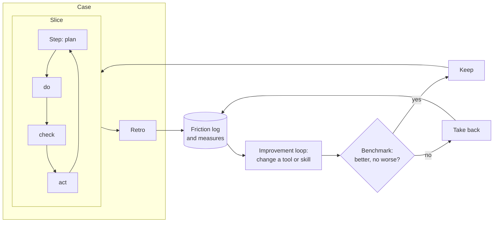

# Proposal: building the four parts in small steps, with loops that check and improve

Status: **proposal**, for discussion. Date: 2026-11-14.

**Names since this was written** (2026-11-18): Bruinet is one product in four modules. Lirenet is Bruinet's **Spec** module, Frainet **Develop**, Gaminet **Migrate**; `lirenet check`, `lirenet trace`, `frainet check` and `frainet trace` are `bruinet spec check` and `bruinet spec trace`. The decision is AD-044 (`.docs/decisions/ad-044-one-product-four-modules.md`). The text below keeps the names it was written with.

| | |
| --- | --- |
| What | How to build **Bruinet** (tests), **Lirenet** (specs), **Gaminet** (migration) and **Frainet** (the factory) without a big design up front: thin slices through all four, each a loop with its check written first, and one loop above them that improves the tools from what the slices cost |
| Builds on | `.my/lifecycle/lifecycle-proposal.md` (the four parts), `.my/lirenet/lirenet-proposal.md`, Frainet's loops notes (plan, do, check, act; loops in loops), the Tiny note (small prompts, exact gates), and what Bouw7 already does: stages that end in **Learn** and **Fix friction**, and a friction log with 33 rows |
| The short version | Do not build four tools and then join them. Take **one rule of one product through all four parts**, badly but end to end, then widen. Use the tools to build the tools. Prove each check by breaking something on purpose. After every slice, fix what was slow before starting the next |

## 1. In one paragraph

The four parts depend on each other, so building them one after another would mean a year before
anything is proven. Instead we build a **walking skeleton**: the thinnest path through all four,
on the Todo sample, where we own everything and know the right answer. Every step is one turn of
a loop: the check is written first, an agent does the work, the check judges it, and the result
and its cost are recorded. Steps make slices, slices make cases (Todo, then Bouw7, then a real
migration). Above them runs the **improvement loop**: every place the work was slow, wrong or
needed a person becomes a row in the friction log, and the worst rows are fixed in the tools
before the next slice starts. The system validates itself in two ways: checks are trusted only
after they have **caught a fault we planted**, and the factory is measured on a fixed set of past
steps that it must still be able to do after every change to it.

## 2. Principles

| # | Principle | Why |
| --- | --- | --- |
| P1 | **A slice goes through all four parts**, thin, before any part goes deep | The joins between parts are where the design is wrong; find that in week one |
| P2 | **The check comes first.** A step's "done when" is something that runs and can fail, written before the work | A loop can only run without a person when its check is exact |
| P3 | **A check must have failed once.** No check is trusted until a planted fault made it red | A check that cannot fail proves nothing, and agents are good at making checks pass |
| P4 | **A step is small**: at most one AI day, one thing proven. A step that fails twice is split, not pushed | Small steps keep the cost of being wrong small |
| P5 | **Real cases, in order of difficulty**: Todo (ours, small, answer known), Kofflard and Tomorrow (ours, real, under development: where the record folder `.developer/` is tried), Bouw7 (real, not ours), a migration pair (real, with source code) | Nothing is built ahead of a case that needs it |
| P6 | **The tools build the tools.** A new feature of Lirenet gets a Lirenet spec, Bruinet tests, and is built by Frainet's loop | The first user finds the most friction, and we are always available |
| P7 | **Fix friction before the next slice**, within a budget | Otherwise the log only grows, and every slice pays the same cost again |
| P8 | **Tiny prompts, exact gates.** A correction is added to a skill only after a run showed it was needed, and removed when a run shows it no longer is | The Tiny note: the craft is in the model; ours are the facts and the gates |
| P9 | **An agent never changes its own judge.** Checks, guards and the verdict rule change through a designed mechanism with a judge of its own (section 5.4); until that design exists, with a person's yes | Self-improvement must not be able to lower the bar, and a person must not stay the only way to move it |

## 3. The loops

Four loops, each inside the next, all turning plan, do, check, act.

| Loop | Size | Plan | Do | Check | Act |
| --- | --- | --- | --- | --- | --- |
| **Step** | AI hours | The step file: what, and the check | An agent builds | The check, a planted fault, the build and tests | Commit on green; record the numbers; red twice → split |
| **Slice** | AI days | The slice's demo: one scenario that needs all its steps | Its steps | The demo runs; a person looks once | Retro: friction rows, lessons |
| **Case** | AI weeks | What the case must prove (Todo: it works; Bouw7: on a real system; migration: on real code) | Its slices | The owner accepts; the numbers against the last case | Decisions recorded; the plan for the next case redrawn |
| **Improvement** | Across all | The worst friction rows and escaped faults | A change to a tool, a skill or a check | The **benchmark** (section 5.3) before and after | Keep the change, or take it back |



The step and slice loops can run dark from the start, because their checks are exact. The case
and improvement loops start with a person: the owner accepts a case, and a person approves any
change to a gate, until the design for that kind of change is accepted (P9, section 5.4).

## 4. How the system is validated

"The tests pass" is not enough when agents write both the work and the tests. Five ways to know
the checks themselves are sound:

| # | Way | How | Where it exists already |
| --- | --- | --- | --- |
| V1 | **Planted faults** | Break something on purpose and require the check to go red: a broken copy of a spec per finding; the app with one rule broken (a title of 101 characters accepted) must turn that rule's trace red; a wrong conversion must fail the comparison | Frainet's tests have a broken spec per finding; mutation testing in the `dotnet-quality-checks` stack |
| V2 | **Known answers** | Use cases where the right result exists and is held back. Todo has **two implementations of the same behaviour** (the MAUI app and the web app), an API and a database: a migration pair with the answer known | The Todo sample |
| V3 | **The rebuild test** | Remove one unit that exists (a screen of Todo web), let the factory rebuild it from the spec and the rules, and judge the rebuild with the tests the original passed | New; Frainet's plan step 5 is its smallest form (rule R11, built from the spec alone) |
| V4 | **Another reader** | The reviewer is never the builder: another agent, another model where possible, and the model-free checks as the last word | The capability loop in the loops notes |
| V5 | **A person's sample** | A person checks a sample of what ran dark. Start at every result; halve the sample each time ten in a row agree; double it after one disagreement | New |

V1 applies to every step (P3). V2 and V3 are why Todo comes first: on Bouw7 nobody knows the
right answer in advance.

## 5. How the system improves itself

### 5.1 What is measured, per step

Written by the loop, not by a person, into one table (Markdown and JSON):

| Measure | Says |
| --- | --- |
| Turns to green | How hard the step was for the agent |
| Human minutes | How dark it really ran |
| Cost | Tokens and clock time |
| Escaped faults | Faults found later that an earlier check should have caught, with the step they came from |
| False alarms | A red check on work that was right |
| No-rule stops | Times the agent had no rule or fact to go on and had to ask |
| Rework | Steps redone, and by which rule or skill |

### 5.2 What each kind of finding turns into

| Finding | Becomes | Never only |
| --- | --- | --- |
| An escaped fault | A new check, or a planted fault added to V1 | A fix |
| A false alarm | A looser check, or an error turned into a warning | Ignored |
| A no-rule stop | A fact in a context file, a transform rule, or a spec's open question | A longer prompt |
| A slow or manual place | A friction row: a tool change, or "won't fix" with the reason | A workaround left in place |
| A correction that no longer helps | Removed from the skill (P8) | Kept "to be safe" |

After each slice an agent writes the retro from the measures and the log: the three changes it
would make, each with what it expects to improve. A person picks.

### 5.3 The benchmark: testing the factory itself

The factory changes all the time: a skill is edited, a check is added, a new model arrives. To
know whether a change helped, keep a **fixed set of past steps** as replayable tasks: the brief
as it was, the repository at that commit, and the checks that judge the result.

- A step joins the set when it taught something: it failed first, or exposed a friction row.
- A change to the factory is tried by running the set before and after: green count, turns, cost,
  human minutes.
- A change is kept when nothing got worse and something got better. Otherwise it is taken back.
- The same set answers "is the new model better for us", and "can this skill be shorter".

It starts with three steps from slice 1 and grows by one or two per slice. Kept small on
purpose: it must be cheap enough to run for every change.

### 5.4 What improves itself now, and what needs a design first

Everything here can improve automatically in the end. Some of it can today, because its check is
exact. The rest needs a **design** first: a mechanism that says who proposes the change, what
judges it, and how it is taken back. Until that design is accepted, a person decides.

| Changes dark today | Why it can |
| --- | --- |
| Skills and prompts, facts in context files | The benchmark judges the change (5.3) |
| Tools' code | Their own tests, and the benchmark |
| New checks and new planted faults | They only raise the bar |
| The benchmark set growing | It only adds evidence |

| Dark once designed | Today | What the design must settle |
| --- | --- | --- |
| A check, guard or gate made weaker or removed | A person | The evidence that it was wrong (false alarms counted over runs); a judge that is not the agent it judges; the planted faults that must still go red after the change; how it is put back when an escaped fault follows |
| Who judges whose work | A person | How the judge is picked (another agent, another model, the model-free checks) and how a judge is itself checked: planted faults for reviewers, agreement with the person's sample (V5) |
| Accepting a spec | A person | What stands in for the owner's yes: the app's own behaviour for a spec drafted from it, the owner's earlier answers for one like it; which open questions always go to the owner |
| Accepting a transform rule or an intended difference | A person | The known answers it must reproduce (V2, V3) before it counts; how far one acceptance reaches (one unit, one module, a pack) |
| Removing a task from the benchmark | A person | When a task is spent: every change passes it and it no longer tells two changes apart; what replaces it |

Each design is a step of its own, built like any other: its check first, a planted fault, a
record. The order follows the cost: the row a person spends most minutes on is designed first.
The person's sample (V5) stays as the measure of whether a design holds: a row goes dark when the
sample agrees with the mechanism, and comes back to a person when it stops agreeing.

### 5.5 A budget, so improving does not eat delivering

Between two slices: fix the friction rows that cost most, up to about a fifth of the slice's own
effort. The rest stay in the log with their cost, and rise by themselves when they cost again.

## 6. The steps

Each slice is a demo that needs every part it touches. Parts: **B** Bruinet, **L** Lirenet,
**G** Gaminet, **F** Frainet.

### Case 1: Todo. Ours, small, the answer known

| Slice | The demo | Steps, each with its check | Parts | Planted fault (V1) |
| --- | --- | --- | --- | --- |
| **0 The loop by hand** | One step done through the loop, with its record | The step file format · the measures table · the friction log · the benchmark folder | F | A step file without a check is refused |
| **1 One rule, end to end** | TOD.02.R11 goes from spec to a passing test, built by an agent from the spec alone | The spec code moved to `Lirenet/`, `lirenet` as a tool · R11's test written dark · the trace reads results and shows R11 passing | L B F | Break R11 in the app: the trace must show it failing |
| **2 Describe** | Todo has a product file and a domain model, and its rules use only defined words | EARS trial on TOD.02, the owner decides · `product.md`, `model.md` · the unknown-word check | L | A rule with an undefined name must warn |
| **3 Build something new** | A journey Todo does not have yet (giving a todo to someone), from an accepted spec to green tests, dark | The spec, accepted by the owner · the loop builds it task by task · a second agent reviews | L F B | A build that skips one rule must be caught by the trace |
| **4 Compare two runs** | The same scenario on Todo's MAUI app and its web app, differences side by side | The behaviour record, screen layer · the comparison report | B | A changed label on one side must show as a difference |
| **5 Below the screen** | The comparison also shows the calls made and the rows changed | Observed traffic · store objects on Todo's SQLite · the effect of a scenario | B | A todo saved with the wrong status must show in the database layer only |
| **6 Migrate, answer known** | One screen of Todo web is removed and rebuilt from the MAUI app by transform rules, judged by the tests the original passed (V3) | The inventory and the ledger · source and target described · three transform rules · the unit loop | G F B L | A rule applied wrongly must fail the comparison and name the rule |
| **Case check** | The owner reads the numbers of seven slices and the friction log, and says what Bouw7 should prove | | | |

### Beside case 1: Kofflard and Tomorrow. Ours, real, under development

Not a case with slices of its own: the two products where the record folder `.developer/` is
tried on real work. A change that is wanted anyway in Kofflard, then one in Tomorrow, is done as
steps through the loop: a spec of the journey, the check first, the record written. What the
folder lacks or holds for nothing shows there, before the tools and the other cases use it.
Kofflard first (small, one app), then Tomorrow (two apps, and a record folder of its own already: its `.sdlc/`, renamed `.developer/`).

### Case 2: Bouw7. Real, not ours, a login only

| Slice | The demo | Parts |
| --- | --- | --- |
| **7 Describe a real system** | One module (Invoices or Hours) described from the running app: inventory from the Scraper, a drafted description, the owner corrects it | L B |
| **8 Pin and observe** | That module's rules traced to passing scenarios on acc, with the calls each scenario made | B L |
| **9 Compare across time** | Yesterday's behaviour record against today's: what changed on acc without anyone telling us | B |

Bouw7 web has no source code for us, so it proves description and checking, not conversion.

### Case 3: a real migration. Real code, both sides

| Slice | The demo | Parts |
| --- | --- | --- |
| **10 Set up the migration** | The old app's inventory in the ledger; source and target architecture; one worked example; the first transform rules, accepted | G L |
| **11 One module dark** | The loop converts a module unit by unit; a person only accepts rules and the module | G F B |
| **12 The data** | Moved data reconciled; the report signed | G B |
| **13 A pack** | The rules of this pair lifted into a pack; the second module starts from it and is measured against the first | G |

After every slice: retro, friction within budget, one or two steps added to the benchmark.

## 7. Where it is written down

One folder, in the style Bouw7's `.testing/` already uses, so a person and an agent read the same
files and a loop can start cold. It is named after the kind of project: **`.developer/`** for a
development project, **`.migrator/`** for a migration project, which adds the inventory, the
ledger, the architectures, the transform rules and the differences
(`.my/structure/folder-structure-proposal.md`):

```text
.developer/   or   .migrator/
  000-Readme.md         what this is, how to run a step
  100-Loops.md          the state of each slice and case; what waits for a person
  200-Steps/            one file per step: what, the check, the planted fault, the result
  300-Measures.md       the table of section 5.1 (and measures.json)
  400-FrictionLog.md    as Bouw7's: what happened, cost, workaround, change, where
  500-Benchmark/        the replayable steps of section 5.3
  600-Retros/           one per slice: the numbers, three proposed changes, what was picked
  decisions/            numbered decisions, as now
```

## 8. Who does what

| | Does |
| --- | --- |
| **A person** | Picks the next slice · accepts specs, transform rules and cases · approves any change to a gate · checks the sample (V5) · picks from each retro. Each of these but the sample goes to a mechanism once its design is accepted (section 5.4) |
| **Builder agent** | One step: reads the step file, does the work, runs the checks |
| **Reviewer agent** | Reviews a step it did not build; runs the planted fault |
| **Retro agent** | After a slice: measures, friction, three proposals |
| **The checks** | The verdict |

Claude Code or Copilot in VS Code, through the same skills and step files.

## 9. Risks

- **Improving for Todo only.** A factory tuned on one small sample fits that sample. Mitigation:
  the benchmark takes steps from every case, and Bouw7 starts early (slice 7), not after polish.
- **The bar slides down.** Agents make checks pass, and section 5.4 lets gates change dark once
  designed. Mitigation: P3 and P9, no gate changes dark before its design is accepted, the
  planted faults must still go red after every change, and escaped faults are the measure that
  shows it.
- **Case 3 has no known answer.** A real migration cannot be judged the way Todo can (V2, V3).
  Mitigation: we already have a finished migration, with its source, its target and what was
  decided along the way. It can serve as a known answer for Gaminet and as benchmark tasks from
  real code. **It is not used yet**: it stays out of the cases, the transform rules and the
  benchmark until case 1 is done, so the factory is not fitted to it before it can be measured
  on it.
- **Measuring costs more than it gives.** Mitigation: the loop writes the measures; if a number
  is never used in a retro within three slices, it is dropped.
- **Improving instead of delivering.** Mitigation: the budget of section 5.5.
- **A walking skeleton looks unfinished for a long time.** Each part is thin until late. That is
  the price of finding the joins early; each slice still ends in a demo that works.
- **One author.** The steps are small so that most run dark; a person's time goes to accepting
  and choosing. If human minutes per step do not fall across slices, stop and find out why.

## 10. Open questions

- Where does the tools' own `.developer/` live: in the container repository, in Bruinet's, or
  with Frainet? Proposal: one in Bruinet's repository, for all four tools, since a slice goes
  through all of them; a product like Bouw7 keeps its own (`.testing/` is one already). See
  `.my/structure/folder-structure-proposal.md`.
- Which journey for slice 3? Proposal: "giving a todo to someone", which TOD.02 lists as not
  planned: small, new, and it touches screen, API and database.
- Which screen for the rebuild test in slice 6? Proposal: the edit form of Todo web: it has
  rules, validation and a save, and TOD.02 and TOD.04 already test it.
- How big is the friction budget? Proposal: a fifth of the slice, reviewed after case 1.
- Does the benchmark run on every change or nightly? Proposal: on every change to a skill or a
  check while it is under ten steps; nightly after that.
- When is a second model used as reviewer (V4)? Proposal: from slice 3, where the first real
  build happens.
- Which design of section 5.4 comes first? Proposal: weakening a check, since false alarms are
  measured from slice 0 and the planted faults already say what must stay red.
- When does the existing migration come in, and as what? Proposal: after the case check of
  case 1, first as held-back known answers for slice 10 and 11, not as examples the rules are
  written from.
- Is slice 0 worth a slice, or should the loop's files grow during slice 1? Proposal: keep it,
  but as one day: a loop without a record cannot be improved, and slice 1 is where records start.
