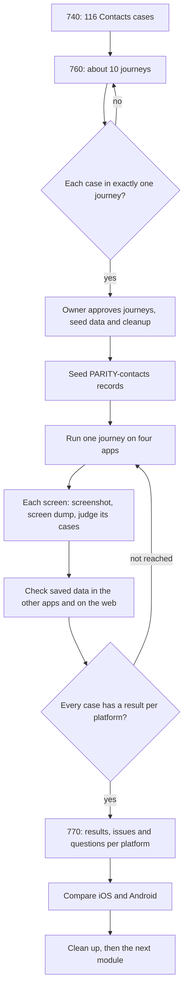

# Automating the device parity flow

Status: proposed, 2026-11-16. Part of [the plan](000-Plan.md). It builds on the proof of concept
in [the Contacts pilot](030-Contacts-Pilot.md).

## The flow

The device parity flow takes the 116 cases in the Contacts device test plan (the 740 file) and
groups them into about ten journeys. It runs each journey on four apps: native iOS and
Construction on two identical iPhone simulators, and native Android and Construction on two
identical Pixel emulators. On every screen it judges the cases that belong there. Then it checks
the saved data in the other apps and on the web, and writes the results per platform to a 770
file.

## What the proof of concept already gives

The proof of concept answers the hardest question in this flow: one journey, written once,
runs unchanged on two very different apps. J0 runs from the same feature file on Construction
for Windows and on native Android, live on Acceptance, with no mock backend.

These parts of the flow exist today:

- **Journeys as feature files.** The 760 journeys become scenarios in a feature file such as
  `CTS.J-contacts-parity.feature.md`. Each app runs them through its own head: a fixture, pages
  and steps.
- **Login without the portal screen.** Native Android logs in through the app's login link with
  a portal refresh token from the API. No one types a password, and no token is logged.
- **Seed data and cleanup through the API.** The shared steps create contacts on Acceptance, which
  is what the web shows. Each run deletes what it made, even when a step fails, and removes what
  crashed runs left a day ago or more.
- **Screenshots and screen dumps.** Each Bruinet driver can already save a screenshot and the
  screen's tree, on Windows, Android and iOS. Today that happens only when a step fails.
- **Results.** Every run leaves a pass or fail per step. The Bruinet MCP server lists the
  results, shows a run's trace and reruns one scenario.
- **Head check.** Each app's head lists the journey phrases it cannot run yet. That is the
  start of the gap check, but per phrase, not per case.

## What we still need

Ordered from the start of the flow to its end.

| Flow step | Still needed | Size |
|---|---|---|
| Cases into journeys | A way to tag each step with the 740 case it covers, and a checker that each case sits in exactly one journey | Small |
| Seed data | A fixed `PARITY-contacts` set, kept between runs, next to the per-run records | Small |
| Four apps | Native iOS (the Mac is on it), and a live Acceptance login for Construction on Android and iOS | Medium |
| Two devices per platform | Two Appium sessions side by side on one machine | Medium |
| Each screen | A screenshot and screen dump after each step, named by journey, step, app and platform | Small |
| Judging cases | A skill that reads the screenshots and dumps and writes a verdict per case | Medium |
| Saved data elsewhere | One run shared by several apps, so one app writes and another reads | Medium |
| Gap check and 770 | A report that turns the results into a case-by-platform table | Small |
| Cases a journey cannot reach | A rule for airplane mode, other rights, restarts and upgrades | Decision |
| Next module | Pages and steps per app for Employees, then Hours | Per module |

### Cases into journeys

A journey covers a case when one of its steps carries that case's number, such as
`@case:B3`. The checker reads the feature file and the 740 table and lists cases that are in no
journey or in two. It works like the head check, which already reads the same files.

### Four apps on two platforms

Native Android runs today. Native iOS waits only on the Mac's J0 run.

Construction already runs on the Android emulator and the iOS simulator through Bruinet, with
Appium or DevFlow, in the existing UI tests. Those tests log in with mock authentication against
the mock backend. The journeys run live on Acceptance, so Construction on Android and iOS needs
only a real login there; that was postponed in step 0, not found broken. Two ways are open:
drive the in-app login web view through its debugging port, as on Windows, or let a Debug build
take a portal refresh token through a link, as native Android does. After that, the journey
head for Windows needs pages and steps that also work on the emulator and the simulator.

### Two identical devices side by side

Each app gets its own emulator or simulator, so both start from the same state. Appium runs
two sessions at once when each has its own device and its own ports. Running the apps one
after the other on one device is the fallback, at twice the time.

### Each screen: evidence and judgement

The steps already assert what a case expects, such as "the list shows only this contact". A
hook after each step saves a screenshot and the screen dump. A skill then reads them and judges
what an assertion cannot, such as layout, usability and texts, and notes differences between
the apps. The assertion decides pass or fail; the skill adds notes and questions and never
changes a result.

### Checking saved data in the other apps

Each head now names its records with its own run prefix, such as `na` for native Android. For
this check, one journey run gets one prefix shared by all four apps. A write journey runs on one
app, then a short check journey runs on the other three. The web check reads the same record
through the API.

### Cases a journey cannot reach

Some 740 cases need airplane mode, a user with other rights, an app restart or an upgrade
install. Restarts and other accounts are easy to automate; the accounts already exist.
Airplane mode works on Android, but the iOS simulator has no switch for it. Upgrade installs
stay manual. The owner decides per case whether it is automated, judged from screenshots
only, or left manual. The checker counts manual cases as covered.

## What it costs

The only measured number so far: the native Android head for J0 took about half a day. That
covered the login, four pages and seven steps. Each later journey reuses most of the pages, so
the cost goes down per journey but grows with each new screen. The full Contacts set touches
about ten screens per app.

## Decision needed

1. Do we tag 740 cases in the feature files as `@case:<number>`, so the checker can work?
2. Do we keep a fixed `PARITY-contacts` seed set on Acceptance, or seed per run as now?
3. Two devices per platform side by side, or one device per platform with the apps one after
   the other?
4. For cases a journey cannot reach: automate, judge from screenshots only, or leave manual?

## Next action

Wait for the Mac's J0 run on iOS. Then build the cheap parts first: case tags with their
checker, the screenshot hook and the results table. With those, the flow runs end to end on
two apps while the live login for Construction on Android and iOS is added.
