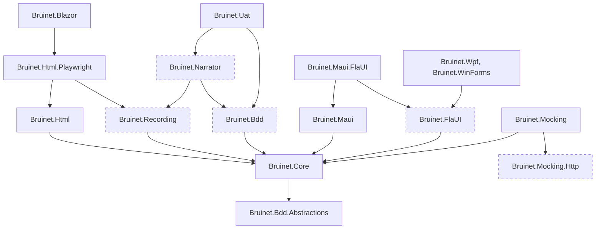

# Packages and first use: review and proposals

Written 2026-11-11 at `b2ea4570`, as review 11 of `.my/reviews2/additional-reviews-proposal.md`.
Packed and run in a throwaway worktree and a scratch folder; both are removed, and nothing in the checkout changed but this file.

## Outcome

The first install does not work yet. `pack.ps1` makes 16 packages, and 7 of its 15 libraries cannot be restored, because they depend on five packages the script never packs.
The quick start names those same packages, and its page object does not compile against the package it names.
Once the missing packages are packed by hand, the Html path itself is short and good: one package reference, one page object, and a first test green in 16 s.

Nothing is published, so every fix below is free. The largest one is a single list in `pack.ps1`.

## What was run and what was read

| Step | How | Result |
| --- | --- | --- |
| `tools/Scripts/pack.ps1 -Version 0.1.0-r11` | Run | 16 packages in 7 min, exit 0 |
| Restore of each of the 15 libraries from that folder alone | Run | 8 restore, 7 fail |
| Html on Playwright, new xUnit project, one test | Run | Green after packing `Bruinet.Recording` by hand |
| Quick start's page object against `Bruinet.Maui` | Run (build only) | 3 compile errors |
| `Bruinet.Core` in a project without xUnit | Run (build only) | CS0012 |
| `dotnet tool install Bruinet.Cli --tool-path` | Run | Installed, `bruinet --help` works |
| All six `Create….Bat` | Run | All exit 0 |
| 16 of the 20 packable projects outside `pack.ps1` | Run (`dotnet pack` each) | All 16 pack |
| bUnit, MAUI, WPF, WinForms, Android, Stride, UAT first use | Read only | No consumer project built |
| `release.yml`, `VERSIONING.md`, AD-026 | Read only | |

The consumer projects used a `nuget.config` that maps `Bruinet.*` to the local folder and everything else to nuget.org, and SDK 10.0.401.

## The packages a consumer sees

Solid boxes are packed by `pack.ps1`; dashed ones are packable projects it leaves out.

What each stack names, read from the csproj files and the packed nuspecs:

| Stack | The consumer names | What arrives with it |
| --- | --- | --- |
| Html on Playwright | `Bruinet.Html.Playwright` | Html, Core, Recording, Microsoft.Playwright 1.62.0, xunit.extensibility.core |
| Html on bUnit | `Bruinet.Html.Bunit`, beside the Playwright one | Html, Core, bunit 2.12.5; `net10.0` only |
| Blazor | `Bruinet.Blazor` | Html.Playwright and all of its own |
| MAUI | `Bruinet.Maui.FlaUI`, `.Appium` or `.Headless`, one per head | Maui, Core, Appium.WebDriver, Selenium.WebDriver; `net10.0` only |
| WPF, WinForms | `Bruinet.Wpf` or `Bruinet.WinForms` | Bruinet.FlaUI, Core, FlaUI 5.0.0; `net10.0-windows` |
| Native Android | `Bruinet.NativeAndroid` | Bruinet.Appium, Recording, Core, Appium.WebDriver |
| Stride | `Bruinet.Stride` in the tests, `Bruinet.Stride.Automation` in the game | Core; the game also gets the test client |
| BDD and UAT | `Bruinet.Uat`, and xUnit by hand | Bdd, Narrator, Recording, Core, Markdig |

## Findings

### 1. Seven of the fifteen packed libraries cannot be restored

- `tools/Scripts/pack.ps1` lines 16 to 32 list 15 projects; `Bruinet.Recording`, `Bruinet.Bdd`, `Bruinet.Narrator`, `Bruinet.FlaUI` and `Bruinet.Mocking.Http` are not among them.
- The packed nuspecs still name them: `Bruinet.Html.Playwright` depends on `Bruinet.Recording` (`src/Bruinet.Html.Playwright/Bruinet.Html.Playwright.csproj` line 13), `Bruinet.Uat` on `Bruinet.Bdd` and `Bruinet.Narrator` (`src/Bruinet.Uat/Bruinet.Uat.csproj` lines 17 and 20).
- Actual output of `dotnet add package Bruinet.Html.Playwright`: `error: NU1101: Unable to find package Bruinet.Recording. No packages exist with this id in source(s): local.`
- The same NU1101 stops `Bruinet.Blazor`, `Bruinet.Uat`, `Bruinet.Mocking`, `Bruinet.Wpf`, `Bruinet.WinForms` and `Bruinet.Maui.FlaUI`.
- What does restore: `Bruinet.Bdd.Abstractions`, `Core`, `Html`, `Maui`, `Maui.CommunityToolkit`, `Stride`, `Stride.Automation` and `Uia.Contracts`. None of them drives an app on its own.
- `release.yml` line 49 and `ci.yml` line 163 both run this script, and neither restores what it made, so a release would publish the broken set.

### 2. Three lists of packages disagree

- `README.md` lines 81 to 121 name about 35 packages.
- 36 projects are packable by their csproj (35 under `src/` and `Bruinet.Cli`); `pack.ps1` packs 16 of them.
- Of the 20 left out, 16 were packed by hand and all pack without error: Appium, Bdd, Contracts, FlaUI, Html.Bunit, Logging, Maui.Appium, Maui.Headless, MauiHeadless, Mocking.Data, Mocking.Http, Narrator, Narrator.Windows, NativeAndroid, Recording and TestData.
- The four `Bruinet.Mocking.Data.*` hooks (AspNetCore, EntityFrameworkCore, its SqlServer, SystemWeb) were not tried.
- So bUnit, MauiHeadless, MAUI on Android and iOS, native Android and SQL replay have no package at all, though README sells each as a head or a tool.
- `Bruinet.Scraper` and `Bruinet.Bdd.Workspace` are in README's table and are `IsPackable=false` (line 7 of each csproj); `Bruinet.Presenter` is a MAUI executable.
- `pack.ps1` line 1 says it packs "the Bruinet library projects that are part of Bruinet.sln"; it packs a hand-kept half.

### 3. The quick start cannot be followed

- It never says where packages come from. `release.yml` lines 3 to 5 say GitHub Packages and "nothing goes to nuget.org"; `VERSIONING.md` lines 288 to 290 say nuget.org.
- It never creates a test project; "Add Packages" (`docs/getting-started/quick-start.md` lines 22 to 31) starts at `dotnet add package`.
- Its list is eight packages for four stacks at once, and four of the eight are among the seven that do not restore.
- Its page object (lines 39 to 62) gave, against the packed `Bruinet.Maui`: `error CS0246: The type or namespace name 'MauiTestContext' could not be found`, `error CS0305: Using the generic type 'Entry<TScope>' requires 1 type arguments`, `error CS0246: The type or namespace name 'Button' could not be found`.
- `Get<T>(Locator)` and a `(context, "Login")` constructor are in no `PublicAPI.Unshipped.txt`; the real form is `new Entry<LoginPage>(this, "UsernameEntry")` and `base(context)`.
- Its test (lines 70 to 93) leans on an `AppFixture` that no doc defines, so a reader has no way to get a context.
- There is no Html example. The working one was copied from `tests/Bruinet.Html.UITests/PageObjects/CounterPage.cs` and `TestBase/BlazorSampleTestBase.cs`.
- Playwright's browser install is only in `docs/run/Html.md` lines 33 to 37, with a path inside this repository.

### 4. xUnit is needed but not declared, and differently per package

- `Bruinet.Core` and `Bruinet.Uat` reference xUnit with `PrivateAssets="all"` (`Bruinet.Core.csproj` line 12, `Bruinet.Uat.csproj` lines 22 and 23), so their nuspecs carry no xUnit dependency.
- Both have public types that derive from xUnit's: `ScreenshotTestAttribute`, `UiFactAttribute`, `UatScenarioTheoryAttribute`, `TestScopeAttribute`.
- Actual output in a project with `Bruinet.Core` and no xUnit: `error CS0012: The type 'BeforeAfterTestAttribute' is defined in an assembly that is not referenced. You must add a reference to assembly 'xunit.core, Version=2.9.3.0'`.
- `Bruinet.Html` and `Bruinet.Maui` declare the same package openly (`Bruinet.Html.csproj` line 13, `Bruinet.Maui.csproj` line 20).
- The effect: every stack is tied to xUnit 2.9.3, and only two of the four packages say so.

### 5. No package has a readme, and the metadata is one text for all

- `pack.ps1` printed 15 times: `The package Bruinet.Html.Playwright.0.1.0-r11 is missing a readme.` Only `Bruinet.Cli` has one (`tools/Bruinet.Cli/Bruinet.Cli.csproj` line 43).
- `PackageReadmeFile` is set in the root `Directory.Build.props` line 22, which `src/Directory.Build.props` does not import.
- Every package carries the same tags, `ui-testing automation wpf maui blazor playwright testing page-object` (`src/Directory.Build.props` line 35), so `Bruinet.Stride` is tagged wpf and blazor.
- `PackageProjectUrl` (line 32) points at a private repository.
- License (MIT), description, authors and repository commit are present in all 32 that were packed.

### 6. Heavy or surprising dependencies

- `Bruinet.Maui` brings Appium.WebDriver, Selenium.WebDriver and System.Drawing.Common to every MAUI suite, the headless and Windows ones too (`Bruinet.Maui.csproj` lines 17 and 18: "to catch StaleElementReferenceException").
- `Bruinet.Html.Playwright` brings `Bruinet.Recording` for the narrator's recorder (csproj line 13); a suite that never records still gets it.
- `Bruinet.Uat` brings Narrator, Recording and Markdig, and ships as an executable with `Bruinet.Uat.runtimeconfig.json` in `lib/` (csproj lines 8 to 12, AD-025).
- `Bruinet.Stride.Automation`, the part inside the game, depends on `Bruinet.Stride` and `Bruinet.Core` (csproj lines 18 and 19), so the game ships the test client; its restore resolved 104 packages.
- `Bruinet.Blazor` names Microsoft.Playwright itself, beside getting it from `Bruinet.Html.Playwright` (csproj line 16).
- `Bruinet.Cli` is a 103 MB package and 469 MB installed: `.playwright/node/win32_x64/node.exe` is 92 MB, and it carries `libmsalruntime.so` (38 MB) and the macOS ones from Microsoft.Data.SqlClient.
- The `net8.0` and `net9.0` builds depend on Microsoft.Extensions.DependencyInjection 10.0.12.

### 7. The framework claim is wider than the packages

- `README.md` line 79: "Packages target `net8.0`, `net9.0` and `net10.0`".
- `net10.0` only: Maui, Maui.Appium, Maui.Headless, Maui.CommunityToolkit, Mocking, Mocking.Http, TestData, Html.Bunit, Stride.Automation, Contracts, MauiHeadless.
- `net10.0-windows` only: FlaUI, Wpf, WinForms, Maui.FlaUI, Uia.Contracts.
- A `net8.0` Html suite that adds `Bruinet.Mocking`, as quick start line 29 says, would not restore (read, not run).

### 8. `VERSIONING.md` describes another product

- Its examples are `Bruinet.Maui.Controls.1.0.0.nupkg` (lines 276 to 281); there is no such project.
- Line 387 gives `dotnet package-info`, which is not a dotnet command.
- Lines 436 and 438 link `plan/PLAN-011-…` and `src/Bruinet.Maui.Controls/PACKAGE-README.md`; neither exists.
- It promises `AssemblyVersion` as MAJOR.0.0.0 (line 284); `pack.ps1` line 35 passes `-p:Version` only, and the props fix `AssemblyVersion` at 0.1.0.0.

### 9. The `Create….Bat` scripts are not for a new user, and leave a dirty tree

- All six rebuild `bruinet` and regenerate `.gen.cs` inside `src/` (`CreateHtml.Bat` lines 8 to 20). They are a contributor's tool after a template change, which `docs/run/Html.md` lines 22 to 29 does say.
- Each ran in about 20 s and exited 0: Html and Blazor 21 files, Maui 68, native Android 29, Stride 10, WinForms 24, Wpf 23.
- After all six, `git status` showed 175 modified files and `git diff --ignore-cr-at-eol` showed none: the generator writes LF over a CRLF checkout.
- The scripts print "Done" either way, so a contributor cannot tell a real change from line endings without diffing.

### 10. Small things

- README lines 15, 43 and 54 and `framework-overview.md` line 14 name Selenium as a driver; no Bruinet project wraps it.
- 21 `InternalsVisibleTo` entries for test assemblies ship in unsigned packages (for example `Bruinet.Html.csproj` line 17).
- No test project's code ships. `Bruinet.Presenter` references `samples/Bruinet.Maui.AppSupport` (csproj line 42), which matters only if it is ever packed.
- `README.md` line 149 says `dotnet tool install -g Bruinet.Cli` with no feed.

## What worked

- `pack.ps1` itself: 7 minutes on a busy machine, no warnings but the readme one, package validation on.
- Html on Playwright with the five packages present: restore 1 s, build 8 s, one test green in 16 s, 5 Bruinet assemblies in the output.
- The Html page object reads well: a control is `new(this, "[data-testid='increment-btn']")`, and the test is two lines.
- `bruinet` as a tool: installs in 3 s from the local folder and lists its commands.

## Proposals

1. **Pack every packable project.** `pack.ps1` takes its list from the projects under `src/` that are not `IsPackable=false`, instead of a hand-kept one.
2. **Prove the packages in CI.** After packing, one small consumer project per stack restores and builds from the artifacts folder alone; a release that cannot be installed then fails before it is pushed.
3. **One package list.** README's Packages table is the packable projects, no more and no less; Scraper, Bdd.Workspace and Presenter leave the table or become packages.
4. **Declare xUnit or move it out.** Either `Bruinet.Core` and `Bruinet.Uat` drop `PrivateAssets` on xUnit, or `ScreenshotTestAttribute` leaves Core so Core is free of a test framework.
5. **A quick start per stack.** Each has four steps: the feed, `dotnet new xunit`, the one package to name, and a page object and test that are compiled in CI from the doc's own file. Html first, with the Playwright install line.
6. **A readme and tags per package.** `PackageReadmeFile` in `src/Directory.Build.props`, a ten-line readme per package saying what to name it with, and tags set per project.
7. **Take Appium out of `Bruinet.Maui`.** Map the stale-element exception in the Appium driver, so headless and Windows suites do not get Selenium.
8. **Free the game from the test client.** `Bruinet.Stride.Automation` references only the wire types, or they move to a small shared package (the public API review's proposal 6, now with a consumer's reason).
9. **Slim `Bruinet.Cli`.** Leave Playwright's Node driver to the Scraper's first use, and publish SqlClient for the tool's own platform only.
10. **Say the truth about frameworks and feeds.** README line 79 names which packages are `net10.0` only; `VERSIONING.md` is rewritten against `release.yml`, or deleted in favour of it.
11. **Make the generator quiet.** `controls generate` writes a file only when its content changed, compared without line endings, and the `Create….Bat` scripts print how many did.

## Not done

- No browser install was needed or made: Playwright's Chromium was already on this machine, so the "browser missing" stall a new user meets was not seen.
- No consumer was built for bUnit, MAUI, WPF, WinForms, native Android, Stride or UAT; their rows are from csproj files and nuspecs.
- Nothing was pushed to a feed, so the GitHub Packages path (sign-in, source mapping) is read from `release.yml` only.
