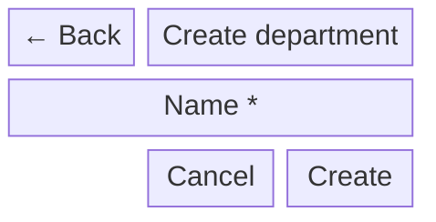
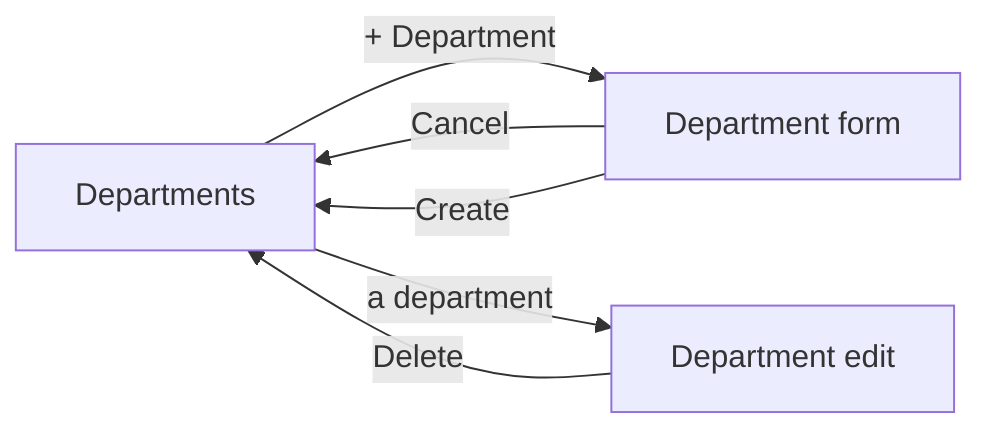
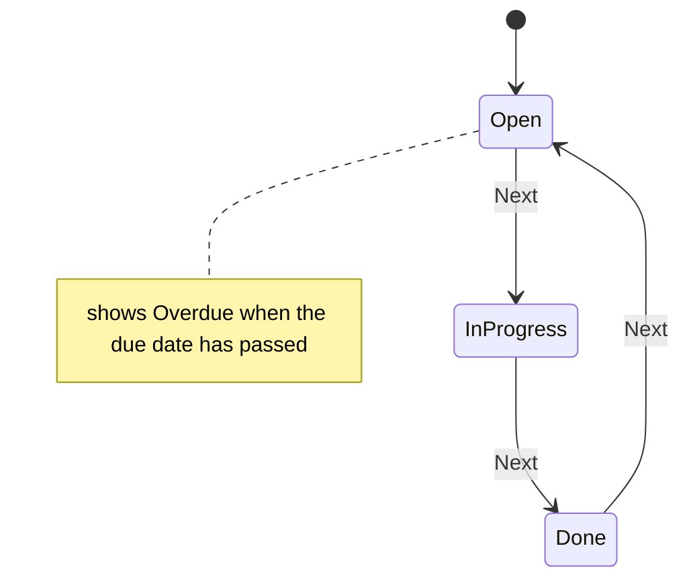
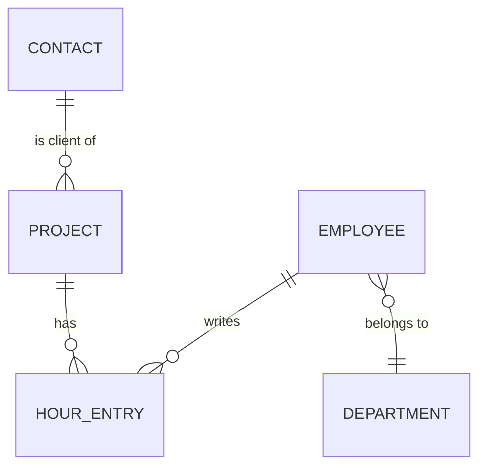
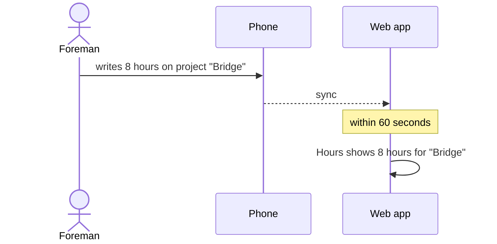
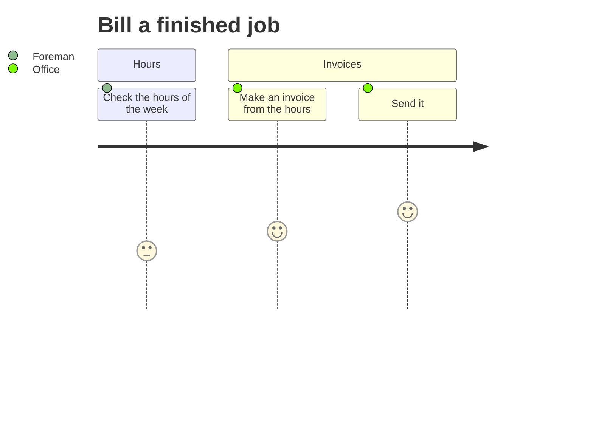

# Visual styles

Pictures answer "how is it laid out" and "how does it move" questions, which text answers badly. All
proposals here are **Mermaid in Markdown, or an image Bruinet already makes**, so they render on
GitHub and in VS Code without a tool, diff as text, and Lirenet can read the names in them. Score
cards as in the [readme](000-Readme.md): C1 read · C2 write · C3 exact · C4 check · C5 run · C6 diff
· C7 draw. The exact formats are not designed yet; the snippets only show the idea.

## Screens

Three ways to show what a screen holds (Q1). They are alternatives; the trial picks one or two.

### P1 Screen card

A small table: the screen's name, how it is reached, and its parts top to bottom.

| Department form | |
| --- | --- |
| Reached by | "+ Department" on Departments |
| Title | Create department |
| Top buttons | Back |
| Fields | see the field table |
| Bottom buttons | Cancel · **Create** |

- The simplest; it is a table, so it checks and generates like one: "the title says …", "these
  buttons are there and no others".
- **Becomes tests:** the whole card is the page's smoke check (Q15).

| C1 | C2 | C3 | C4 | C5 | C6 | C7 |
| --- | --- | --- | --- | --- | --- | --- |
| ●●● | ●●● | ●●● | ●●● | ●●● | ●●● | ●●○ |

### P2 Sketch (a wireframe in Mermaid)

The screen as boxes, in the order and grouping a person sees. Mermaid's `block` diagram draws it.



- Shows grouping and order at a glance, which a card does not.
- **Fragile at scale:** a form of 40 fields is a wall of boxes. Good for a screen's shape, not its
  every field; the fields stay in the field table.
- Lirenet reads the box labels and checks them against the screen's names.

| C1 | C2 | C3 | C4 | C5 | C6 | C7 |
| --- | --- | --- | --- | --- | --- | --- |
| ●●● | ●●○ | ●●○ | ●●○ | ●○○ | ●●○ | ●●● |

### P3 Annotated screenshot

A real screenshot with numbered marks, and a table that says what each number is.

```text


| # | What | Note |
| --- | --- | --- |
| 1 | Title | "Create department" |
| 2 | Name | required, marked with * |
| 3 | Create | disabled until Name is filled? (open question) |
```

- **Answers Q14, "does it look right"**, which nothing else does. The owner points at it.
- **Made by Bruinet, not drawn:** the Scraper and the recordings already take screenshots and draw
  touch marks. A draft with numbered marks on every control is a small step from there.
- The picture goes stale when the app changes. The drift check compares it with a new screenshot
  and flags it; it is never the judge of a test.

| C1 | C2 | C3 | C4 | C5 | C6 | C7 |
| --- | --- | --- | --- | --- | --- | --- |
| ●●● | ●●● (drafted) | ●○○ | ●○○ | ○○○ | ●○○ | ●●● |

## P4 Flow

**Answers:** Q5 how a person gets from one screen to another.



- **Nodes are screens, arrows are a person's actions**, both by their names on the screen.
- **Becomes tests:** each arrow is a small check ("Cancel on the form leads to Departments"). And
  navigation leaves the examples: a test that needs the form reaches it by the flow.
- **Check:** every screen is reachable; every arrow is walked by some journey or listed as left out
  (the Lirenet proposal's flow checks).
- **Drafted from the app:** Explore records the ways between pages.

| C1 | C2 | C3 | C4 | C5 | C6 | C7 |
| --- | --- | --- | --- | --- | --- | --- |
| ●●● | ●●● | ●●○ | ●●● | ●●○ | ●●● | ●●● |

**Not for:** what happens *on* a screen. Keep conditions off the arrows, or the flow becomes a program.

## P5 State diagram

**Answers:** Q6 which states a thing can be in and what moves it.



- What an owner understands fastest about a thing's life. The table form (T6) carries more per
  arrow; the two can be made from each other.
- **Becomes tests:** per arrow, and "no other action is offered in this state".

| C1 | C2 | C3 | C4 | C5 | C6 | C7 |
| --- | --- | --- | --- | --- | --- | --- |
| ●●● | ●●● | ●●● | ●●● | ●●○ | ●●● | ●●● |

## P6 Domain model

**Answers:** Q9 what a thing consists of and how things relate.



- Things by the names a person uses, **not tables of the database**. Fields per thing go in a field
  table, not in the diagram, so the picture stays readable.
- **Check:** every thing a rule names is in the model; every relation's ends are things.
- Does not become tests by itself; it is the vocabulary the other styles use.

| C1 | C2 | C3 | C4 | C5 | C6 | C7 |
| --- | --- | --- | --- | --- | --- | --- |
| ●●○ | ●●○ | ●●○ | ●●● | ○○○ | ●●● | ●●● |

## P7 Sequence diagram

**Answers:** Q13 what crosses systems or time.



- The only style that shows two apps and a time limit in one picture. Bouw7's phone → office
  journeys (G5) need it.
- **Becomes tests:** as a mixed-head scenario: each arrow a step on the app it starts from.

| C1 | C2 | C3 | C4 | C5 | C6 | C7 |
| --- | --- | --- | --- | --- | --- | --- |
| ●●○ | ●●○ | ●●○ | ●●○ | ●●○ | ●●● | ●●● |

## P8 Journey map

**Answers:** Q5 and Q16 for a long way through the product: the stages a person goes through,
what they do and see at each, across several screens.



- For the owner's overview of a whole journey, above the screen level. Too coarse to test; it
  points to the journeys that cover each stage.

| C1 | C2 | C3 | C4 | C5 | C6 | C7 |
| --- | --- | --- | --- | --- | --- | --- |
| ●●● | ●●● | ●○○ | ●●○ | ○○○ | ●●● | ●●● |

## Comparing the pictures

| Style | Best for | Becomes tests | Drafted from the app |
| --- | --- | :---: | :---: |
| P1 Screen card | What a screen holds | ☑ | ☑ |
| P2 Sketch | Grouping and order | partly | ☑ possible |
| P3 Annotated screenshot | How it looks | ☐ | ☑ |
| P4 Flow | Getting around | ☑ | ☑ |
| P5 State diagram | A thing's life | ☑ | ☐ |
| P6 Domain model | Words and relations | ☐ (vocabulary) | partly, from the schema |
| P7 Sequence | Across apps and time | ☑ with steps | ☐ |
| P8 Journey map | The big picture | ☐ | ☐ |

## Questions about pictures

- For a screen, card, sketch or screenshot? Proposal: the **card** as the spec (it is exact and
  generates tests), the **screenshot** beside it for the owner (drafted, never the judge), the
  sketch only for screens whose grouping matters (a dashboard).
- Mermaid's `block-beta` is still marked beta. Does that matter? Proposal: only for the sketch;
  if it changes, sketches are redrawn from the card.
- Where are screenshots kept: in git or as artifacts? Proposal: in git, small (PNG, one per
  screen), replaced only when the drift check flags a change and a person accepts it.
- How much may Lirenet read of Mermaid? Proposal: names of nodes, states and participants, and what
  connects to what. A small subset, documented; anything outside it is a finding.
