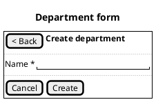

# PlantUML Salt compared with Wireframe

Status: **comparison**, for a decision. Date: 2026-11-18. Follows [310-Screens.md](310-Screens.md),
which gave Salt one row (option 4c), and [320-Wireframe-review.md](320-Wireframe-review.md), which
reviewed and hardened Wireframe. This document sets the two side by side on the needs N1–N8 of 310.

| | |
| --- | --- |
| Salt | Read from PlantUML's own pages: `plantuml.com/salt`, `/command-line`, `/faq-install`. **Not run here**: Java 17 is on this machine, `plantuml.jar` is not, and I did not download it |
| Wireframe | The submodule `wireframes/` at `299f0ab` (the review's fixes). The example below was run through `wire parse` and gave the tree shown |
| Not verified | PlantUML's licence, its latest release, and its JavaScript build: those pages could not be fetched. What is said about them is from memory and marked so |

## 1. In short

**Salt draws a screen; Wireframe describes one.** Salt is a table of cells with a few widget
shapes in them. It has no ids, no attributes, no required mark, no link from a button to a screen,
and no way to give the tree to another tool. Wireframe has all five, and after the review it also
reports what it cannot read instead of dropping it.

For Lirenet that settles it: **Salt meets the picture half of the need and none of the facts half**
(310, "What I think"). It would be an ASCII sketch with a better renderer. What Salt has and
Wireframe lacks is age, users and a keeper: it will still render in ten years without anyone here
doing anything.

Recommendation: **stay with Wireframe as the source**. Take two things from Salt: its short forms
as an idea for a compact notation (section 6), and its place as the fallback picture format if
Wireframe is ever dropped, beside the card and table of 310's option 4a.

## 2. The same screen in both

Bouw7's department form (B7.MST.02), as in 310.

**Salt** (written from the documentation, not rendered):



**Wireframe** (parses with no errors):

```wireframe
wireframe
    %title: Department form
    Vertical
        Horizontal
            Button "Back" @Departments
            Heading "Create department"
        /Horizontal
        TextInput :Name label="Name" required max=100 message="Name is required"
        Horizontal
            Button "Cancel" @Departments
            Button "Create" :Create primary
        /Horizontal
    /Vertical
/wireframe
```

What each one holds:

| Fact | Salt | Wireframe (`wire parse`) |
| --- | --- | --- |
| There is a field | A quoted string in a cell | `controlType: "TextInput"` |
| The field's name | The text in the cell to its left, by position only | `label: "Name"`, `id: "Name"` |
| Required | A `*` typed in the label; means nothing to Salt | `modifiers.required: true` |
| Limit, message | No place. A note outside the picture | `attributes.max: 100`, `attributes.message` |
| Back leads to Departments | No place | `navigation: "Departments"` |
| Create is the main action | Bold text at most | `primary` |
| Where in the file | Not available | Line, column and offset on every node |

Nine lines against fourteen: Salt is shorter because it says less.

## 3. Language

| | Salt | Wireframe |
| --- | --- | --- |
| Model | A grid: `{ }` is a table, `\|` a column, a new line a row; blocks nest | A tree of named elements: layouts, controls, components; closed by `/Name` or by indentation |
| Notation | Symbols: `[OK]` button, `()` `(X)` radio, `[]` `[X]` checkbox, `"text "` field, `^item^` droplist | Keywords: `Button`, `Radio`, `Checkbox`, `TextInput`, `Dropdown` |
| Widgets | Button, radio, checkbox, text field, droplist (closed or open), text area, tree, tree table, tabs, menu, group box, scroll bars, separators, icons (OpenIconic) | 27 control types and 21 components, among them `Table`, `DataGrid`, `Tabs`, `Modal`, `Card`, `Avatar`, `Breadcrumb` |
| Tables | The language *is* a table; `.` an empty cell, `*` a cell spanning from the left; line styles `{#` `{!` `{-` `{+` | `Table` and `DataGrid` components with `columns` and `records`; layout by `Vertical`, `Horizontal`, `Grid` |
| Ids | None | `:Name`, checked for duplicates |
| Attributes | None. Only text styling: Creole, `<color:…>` | Any `name=value`, kept in the tree; numbers typed |
| States | Checked (`(X)`, `[X]`). "Disabled" is grey text by hand | `required`, `disabled`, `readonly`, `checked`, `primary` and others as modifiers |
| Label of a field | The neighbouring cell | `label=` on the input, drawn above the box |
| Navigation | None | `@Target`, `@:back`, `@:modal:Name` |
| Conditions | None | `if` / `else`, `show="else"` |
| Data beside the screen | None | `validations`, `fields`, `rules`, `data`, `calculations` sections |
| Width of a field | The number of spaces inside the quotes | An attribute, or left to the layout |
| Non-ASCII | Text is free | Text free; ids and targets accept Unicode since the review (W6) |
| Inside other diagrams | Yes: `{{salt … }}` in a PlantUML activity node, so a flow can show its screens | In Mermaid through the plugin (not tried in a browser, see 320) |

Salt's notation is quick to write and reads almost as a picture in plain text: `Login | "MyName "`
needs no rendering to be understood. That is its real strength, and also the limit: each symbol
has one meaning and no room for a second fact.

## 4. Against the eight needs

● good · ◐ partly · ○ poor

| Need | Salt | Wireframe | Why |
| --- | :---: | :---: | --- |
| N1 Says what each element is | ◐ | ● | Salt knows about ten shapes, and a label is just text beside a field |
| N2 Carries the spec's facts | ○ | ● | No ids, attributes, required, limits, messages or targets in Salt |
| N3 Reads as a screen | ● | ● | Both render one. Salt also reads half-way as raw text; Wireframe needs the preview or the SVG |
| N4 Text in git, good diffs | ◐ | ● | Both are text. Salt's field widths and cell alignment are spaces, so a longer label can touch other lines |
| N5 Renders where people look | ◐ | ◐ | Neither on GitHub. Salt: VS Code extensions, JetBrains, GitLab with a PlantUML server (from memory). Wireframe: its own VS Code extension. Both need a committed SVG for GitHub |
| N6 Agents, drafted from the app | ◐ | ● | Agents know Salt well from public examples. But the Scraper's facts (kind, label, required, choices) have nowhere to go in Salt except the picture |
| N7 Lirenet reads it, in .NET | ○ | ◐ | Salt: no tree comes out of PlantUML (`--preproc` is source text, `--check-syntax` a yes or no), so Lirenet would write its own Salt parser to learn only shapes. Wireframe: `wire parse` gives JSON; a C# reader is still to write |
| N8 Small to learn and keep | ● | ◐ | Salt is one page of documentation and is kept by others. Wireframe is ours to keep: 12,700 lines, one author |

## 5. Tooling and upkeep

| | Salt | Wireframe |
| --- | --- | --- |
| Runtime | Java and `plantuml.jar` (about 20 MB, from memory). Salt needs no Graphviz, as far as I know; the install page does not say | Node; the packages on npm |
| Output | PNG, SVG, PDF, EPS, LaTeX, and ASCII art (`--txt`, `--utxt`; whether Salt supports the text formats was not checked) | SVG; four themes |
| Machine-readable tree | No | Yes: `wire parse <file>`, and `parse()` in `wireframe-core` |
| A gate in CI | `--check-syntax`, `--stop-on-error` | Non-zero exit on errors, `file:line:col` messages (since the review) |
| Error quality | Not tested here | Line and column on every error; an unknown closing keyword is reported and parsing goes on |
| Same input, same output | Not tested here | Checked: byte-identical SVG |
| Editor | Mature extensions for VS Code and JetBrains, online servers | Own VS Code extension: preview, IntelliSense, diagnostics. Not verified in VS Code itself after the fixes |
| Without the runtime | A JavaScript build of PlantUML exists (from memory, status not verified) | The parser is TypeScript; runs in a browser |
| Maturity | Many years old, widely used, documented; its skinparam and style sections are marked "FIXME" and some settings do not apply to Salt | Version 0.0.7; 485 tests; reviewed once, by us |
| Who keeps it | The PlantUML project | You. Quiet from May to November 2026 (320, question R6) |
| Can we extend it | Not in practice: a Java project with its own roadmap, and a grammar of symbols with no room for attributes | Yes, and the review already did (`label=`, `parse`, strict errors) |
| Licence | GPL by default, with builds under other licences (from memory, not verified) | MIT |

## 6. What Salt does better, and what to take from it

1. **It is kept by someone else.** The largest point against Wireframe (N8, 320's R6) is exactly
   Salt's strength. If keeping Wireframe alive is the worry, Salt does not solve it, because it
   cannot carry the facts; the answer there is 310's fallback 4a, with Salt as the picture.
2. **Raw text that already looks like the screen.** A person reads `Name | "      "` and
   `[Cancel] | [Create]` with no tool. Wireframe's keywords read as a list, not as a layout. Worth
   considering: a short form in Wireframe for the commonest controls (`[Create] :Create primary`
   for a button), read into the same tree. A language decision, and only if authors ask for it.
3. **Screens inside a flow.** `{{salt}}` in an activity diagram shows each step's screen in the
   flow itself. Lirenet could give the same from the `@Target` links: a generated flow with each
   screen's SVG in its node.
4. **ASCII output.** If PlantUML's text output works for Salt, a screen can be pasted into a chat
   or a terminal. A text renderer for Wireframe would serve agents the same way.
5. **Agents already know it.** No instruction file needed. Wireframe needs its language reference
   in the agent's context every time.

A converter from Wireframe to Salt would be possible (the tree is a superset) and the other way
round is not, since Salt has nothing to fill ids and attributes from. I see no use for either now.

## 7. Questions

| # | Question | Proposal |
| --- | --- | --- |
| S1 | Is Salt an option for the source of a screen? | No. It fails N2 and N7, and cannot be extended to meet them |
| S2 | Is Salt the fallback picture if Wireframe is dropped? | Yes, beside the card and table (4a): the table holds the facts, Salt draws them. Better than ASCII, no upkeep |
| S3 | A short, Salt-like form for buttons and fields in Wireframe? | Not now. Note it; decide after the trial of 310, when people have written real screens |
| S4 | Should the comparison be finished by running Salt (render both forms, time them, try a typo)? | Only if S2 becomes real. It needs `plantuml.jar` downloaded, which I did not do without asking |
