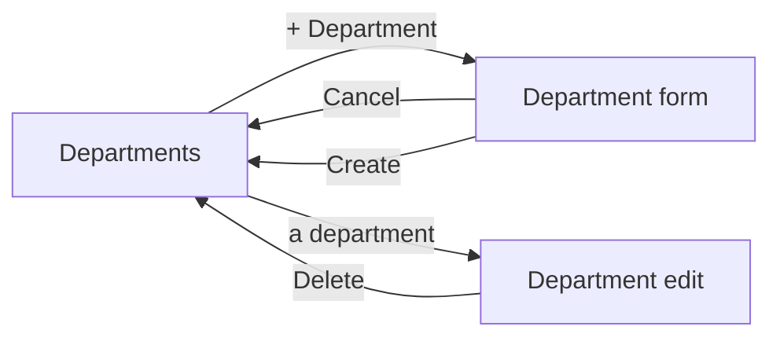

# Two specs in mixed styles: sketches

Not designs: rough sketches of how two real specs could read when each part uses the style the
[question map](100-Questions.md) picks. They exist to make the comparison concrete and to feed the
trial. Formats, ids and headings are all still open.

## Sketch 1: B7.MST.02 Make a department

Today: 107 lines, 5 rules, 25 Gherkin step lines. R1 is eight lines to say the form has a title and
three buttons; R2 is four lines to say one field is required.

What it becomes, split between the **screen** (what the form *is*, shared by every journey that uses
it) and the **journey** (what a person *does*):

### Screen: Department form

| Department form | |
| --- | --- |
| Reached by | "+ Department" on Departments |
| Title | Create department |
| Buttons | Back · Cancel · **Create** |

| Field | Kind | Required | Message when empty |
| --- | --- | :---: | --- |
| Name | text | ☑ | Name is required |

### Flow



### Journey: rules

| Id | Rule | Proven by |
| --- | --- | --- |
| R3 | Cancel makes nothing: the list shows no department of that name. | scenario |
| R4 | Create with a name makes the department: the list shows it. | scenario |
| R5 | Delete on a department's own form removes it from the list. | scenario |

```gherkin
# R3
When I fill in Name with "{run} Cancelled" and tap Cancel
Then the list shows no department named "{run} Cancelled"

# R4 and R5
When I make the department "{run} Test"
Then the list shows the department "{run} Test"
When I delete the department "{run} Test"
Then the list shows no department named "{run} Test"
```

### What changed

| | Today | Sketch |
| --- | --- | --- |
| Lines of spec (rules, examples, screen, flow) | about 75 | about 40 |
| Gherkin step lines | 25 | 6 |
| R1 (the form's parts) | 8 Gherkin lines | the screen card, 3 rows, generated test |
| R2 (Name required) | 4 Gherkin lines | 1 row with a tick, generated test |
| Getting to the form | in every example | once, in the flow |
| Reused by another journey (edit a department) | copied | the same screen and flow |

Intent, Choices and Not in this journey stay as they are. The scenario lines use phrases that
combine two steps ("fill in … and tap Cancel"); whether that is allowed is a question below.

## Sketch 2: TOD.02 Create a todo

Today: 11 rules, each with a Gherkin example, 209 lines (`samples/Todo/specs/TOD.02.spec.md`).

| Today's rule | Question it answers | Style in the sketch |
| --- | --- | --- |
| R1 A new form starts empty, status Open | Q2 fields and defaults | Field table, Default column |
| R2 Title required | Q2 | Field table, a tick |
| R3 Title at most 100 characters, spaces at the ends not counted | Q3 limits | Field table limits, plus an example table for 100 / 101 / spaces |
| R4 A refused save keeps nothing, form stays open | Q12 when it goes wrong | One-line rule (`If … then …`) |
| R5 An error shows only after Save | Q10 order matters | Scenario, 3 lines |
| R6 Spaces at the ends are dropped | Q3 | Example table (same one as R3) |
| R7 Due date optional, switched off clears it | Q7 combination | Decision table: switch × picked date → saved |
| R8 Status may be set before saving | Q2 / Q6 | Field table row for Status; the state diagram of TOD.05 |
| R9 Kept on the device, "Local only" until sync | Q11 | One-line rule, proven by an integration test |
| R10 Save returns to the list, which shows it | Q5 and Q10 | Flow arrow, plus a 2-line scenario |
| R11 A past due date is allowed and shows Overdue | Q7 | The Overdue decision table of TOD.05, one row |

The field table for the todo form, as it would be:

| Field | Kind | Required | Default | Limits | Message |
| --- | --- | :---: | --- | --- | --- |
| Title | text | ☑ | empty | 1–100 characters, ends trimmed | Title is required · Title can be at most 100 characters |
| Notes | text, several lines | ☐ | empty | none; only spaces counts as empty | |
| Due date | switch and date | ☐ | off | any date, past allowed | |
| Status | Next button | ☐ | Open | Open → In progress → Done | |

Four rows say most of what R1, R2, R3, R7 and R8 take five examples to say, and the tests for them
are generated. What stays as sentences and scenarios is what really is behaviour: R4, R5, R9, R10.

## What the sketches suggest

- **About half the lines go**, and nearly all of them were Gherkin about screen parts and getting
  there, as the Bouw7 count predicted.
- **The screen part is shared.** Bouw7 has eight forms; every journey on a form re-describes it
  today.
- **Every rule still has exactly one proof**, but the proof is the simplest one: a tick, a row, an
  arrow, or a scenario.
- **What remains in Gherkin reads better**, because it is only about what happens.

## Questions the sketches raise

- Are there still rule ids for what a table says (R1, R2 in MST.02), or does the table row *become*
  the rule? Proposal: the row is the rule; the trace shows `Department form · Name · required`.
  Old ids that became rows are retired, as ids are never reused.
- May a phrase combine two actions ("fill in … and tap Cancel")? Proposal: no: it hides a step.
  Keep one action per line; the sketch's count goes to 8 Gherkin lines, still a third of today's.
- Is "Proven by" a column the writer fills in, or does the trace fill it? Proposal: the trace;
  a spec never names its tests (as the format says today).
- Do Bouw7's existing specs get rewritten, or only new ones written this way? Proposal: rewrite
  the three trial specs; the rest when they are next touched.
