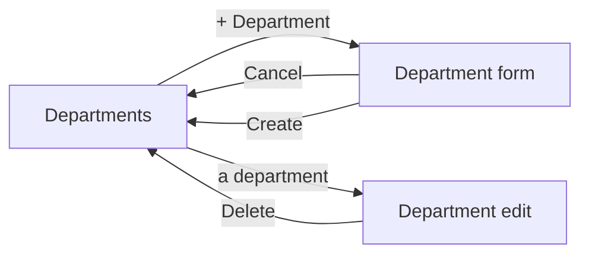

# P4 Flow: automation

The style: [../300-Pictures.md](../300-Pictures.md#p4-flow). Entry point **A, table checks**: each arrow is a
test. And a second use: the flow is how every other test **gets to** its screen. Back to the
[readme](000-Readme.md).

## What the spec says

Nodes are screens (page objects by their `[BddPage]` name), arrows are a person's actions (controls by
their `[BddControl]` name).

## What proves it, by layer

**UI fast** for every arrow; the **judge head** for the arrows on the main path. Below the UI there are no
screens to move between.

## The simplest automation

**One generated test per arrow**: open the arrow's start page, press the arrow's control, check the end
page is open (`the {page} page is open`). No Gherkin, nothing per arrow in C#.

| Arrow kind | How the check presses it | Note |
| --- | --- | --- |
| A button or link (`Cancel`) | `I tap {control}` on the start page | Nothing saved |
| A row (`"a department"`) | The first row of the start page's list | Needs a list with a row; read-only |
| A submit that writes (`Create`, `Delete`) | Only with the data it needs: Create fills the required fields from the field table's first valid values; Delete only on a record the run made | On a shared environment these arrows run only where writes are allowed (Bouw7's acc), with the run marker |

**The flow as navigation for every other test.** Today a test or example gets to a screen by its own steps
(`Given I am on the Departments page`, `When I tap + Department`): about a fifth of Bouw7's Gherkin. With the
flow, Bruinet can find the shortest path from a page that opens by address to the wanted screen, and walk
it. A table check (T1, P1) or an example then starts with `Given the Department form` and nothing more. The
built-in page phrase already runs `NavigateTo<PageName>` when the fixture has one; the flow would provide it
for every screen.

## Checks without a browser

- Every arrow's start and end is a page object, and its label a control on the start page: a binding check,
  as for steps.
- Every screen is reachable from a page that opens by address.
- Lirenet: every arrow is walked by some journey or listed as left out (the flow checks of the Lirenet
  proposal).
- **Drift**: Bouw7's places list (`175-Places.md`, from `bruinet scrape places`) knows the app's places and
  how they were reached; a place with no node, or an arrow the walk never found, is reported.

## What it needs

| Need | Exists? |
| --- | --- |
| Pages and controls by name, the "page is open" check | ✓ |
| Reading a Mermaid flowchart's nodes and labelled arrows | **New**, small; a documented subset |
| Shortest-path navigation for other tests | **New**, medium; replaces per-page `NavigateTo` methods |
| The app's places, for drift | ✓ `bruinet scrape places` (Scraper, today) |

## Questions

- Arrows that need data (open a row): pick the first row, or a named one? Proposal: the first row; a flow
  says where a click leads, not which record.
- May the navigation for other tests pass through a write arrow? Proposal: never; paths for navigation use
  only arrows that do not write.
