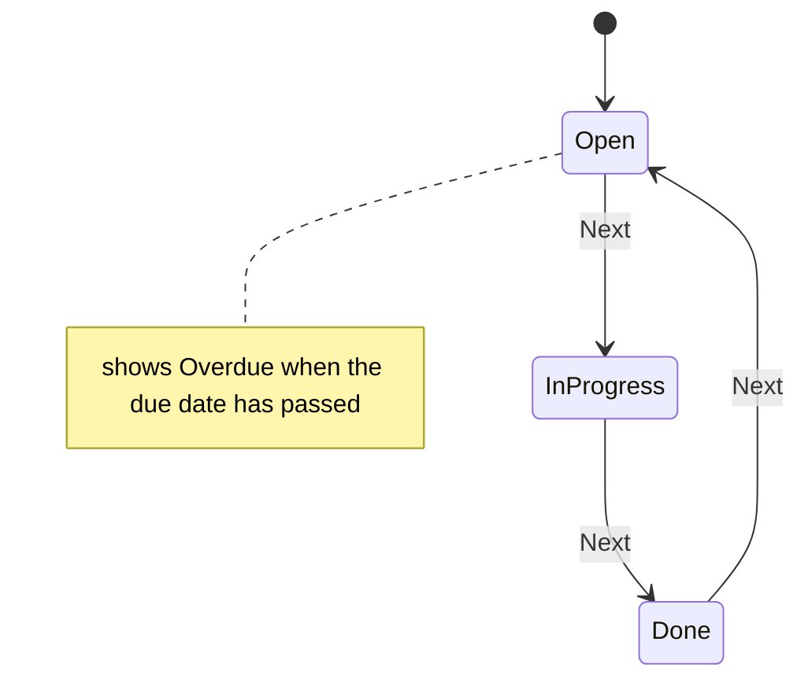

# P5 State diagram: automation

The style: [../300-Pictures.md](../300-Pictures.md#p5-state-diagram). **The same as T6**, the state
transition table: a state diagram and a transition table hold the same facts, and one is read into the
other. Back to the [readme](000-Readme.md).

## What the spec says

## The simplest automation

Lirenet reads the diagram's states and labelled arrows into the rows of a transition table
(From · Action · To), in memory, and every check of [T6](T6-State-transitions.md) runs on them:

| From the diagram | Test |
| --- | --- |
| Each arrow | Unit: from this state, this action leads there (`SpecTable` over the arrows) |
| Each state × action **not** drawn | Unit: refused (`SpecTableComplement`) |
| `[*] --> Open` | Unit: a new record starts Open; UI: a new form shows status Open (the field table's Default, T1) |
| Each state | UI: a record in that state offers exactly its outgoing actions |
| A `note` | Nothing: a note is for the reader. If it is a rule ("shows Overdue when…"), it belongs in a decision table (T4) or a one-line rule |

For Todo's status this is three arrows, three unit cases, six refused pairs, and three state checks on the
screen, all from five lines of Mermaid. Todo tests the cycle today by hand (TOD.05.1, "Cycle in U; the
component's Next button in H").

## What it needs

| Need | Exists? |
| --- | --- |
| Reading `stateDiagram-v2`: states, `[*]`, labelled arrows | **New**, small; a documented subset |
| Everything else | As T6 |

## Questions

- Diagram or table, when both could be written? Proposal: the diagram while it fits on a screen (fewer than
  about ten arrows); the table when arrows need a Who or a condition.
- Nested states and choice points of Mermaid? Proposal: not in the subset; Lirenet reports them as
  unreadable, so nothing is silently skipped.
