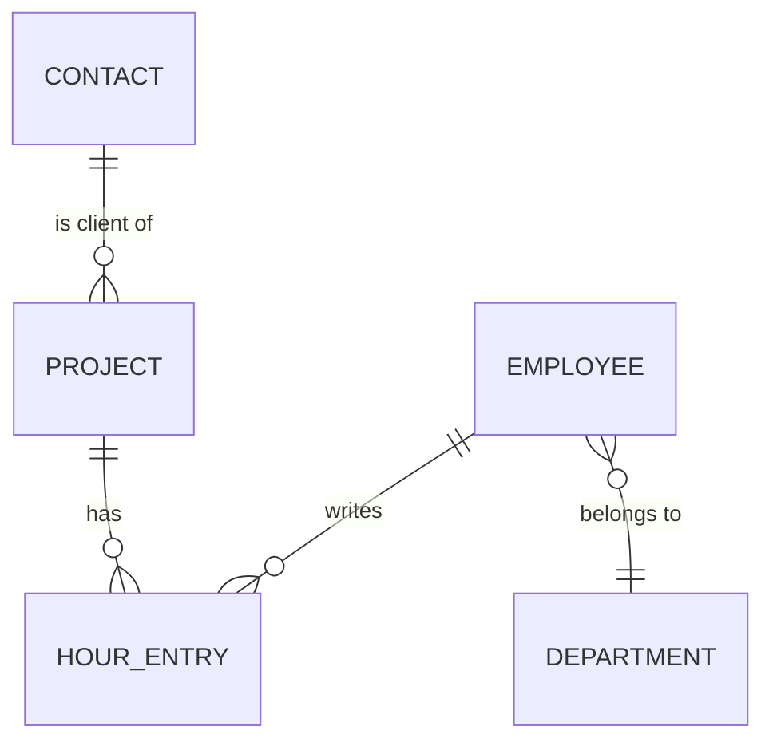

# P6 Domain model: automation

The style: [../300-Pictures.md](../300-Pictures.md#p6-domain-model). **No tests of its own**: a domain model
is the vocabulary the other styles use. What is automated are checks that the model, the test data and the
app's contracts agree. Back to the [readme](000-Readme.md).

## What the spec says

## Why no tests of its own

"A project has hour entries" is true or false only through something a person does or sees: a list of a
project's hours, a refusal to delete a project with hours. Those are rules and examples, tested in their own
style. A test that only says "the type Project has a list of HourEntry" tests the code against a drawing of
the code.

## What is automated

| Check | Against | Layer | Exists? |
| --- | --- | --- | --- |
| Every thing and term a rule, field table or screen names is in the model | The spec files | Lirenet `check` | **New** (the vocabulary check of the Lirenet proposal) |
| **Test data obeys the model**: every hour entry names a project that exists; every employee one department | The suite's test sets | Unit, at test-data load | ✓ `TestDataDefinition.DefineRules` (`UniqueIds`, `Require`, `ForEach`); **new**: rules generated from the relations (one-to-many → the child names an existing parent) |
| **The API returns what the model says**: a project's response has its hour entries, or a link to them | The contracts (`Bruinet.Contracts`, the DTO the app reads) | Integration | ✓ contracts check shape; **new**: a report of model relations no DTO carries |
| **The database has a home for each thing** | The schema snapshot (SQL replay) | none, a report | ✓ snapshot; **new**: a mapping table thing → table, and a report of things with no table. Never a failure: the model is not the schema |

The one that pays most is the **test data** check: test sets are hand-written JSON, and a test set that
breaks a relation makes tests pass or fail for the wrong reason. The relations in the diagram become rules
the test-data loader already knows how to run.

## Cardinality as rules

| In the diagram | Becomes |
| --- | --- |
| `A ||--o{ B` (one A has zero or more B) | Each B in a test set names an A that exists |
| `A }o--|| B` (each A belongs to exactly one B) | Each A names exactly one B; missing is an error |
| `A ||--|{ B` (one or more) | Each A has at least one B in the test set; a warning, since a test set may be partial |

## What it needs

| Need | Exists? |
| --- | --- |
| Reading `erDiagram` things and relations | **New**, small |
| A map from model names to the app's types (`HOUR_ENTRY` → `HourEntryDto`) | **New**: a small table in the suite, never in the spec |
| Test-data rules | ✓ |
| Contract and schema reports | Partly |

## Questions

- Fields in the model, or only in field tables? Proposal: only in field tables per screen; the model stays
  things and relations, so it fits on one screen.
- Should a broken relation in test data fail the run? Proposal: yes, as test-data rules do today, before any
  test runs.
