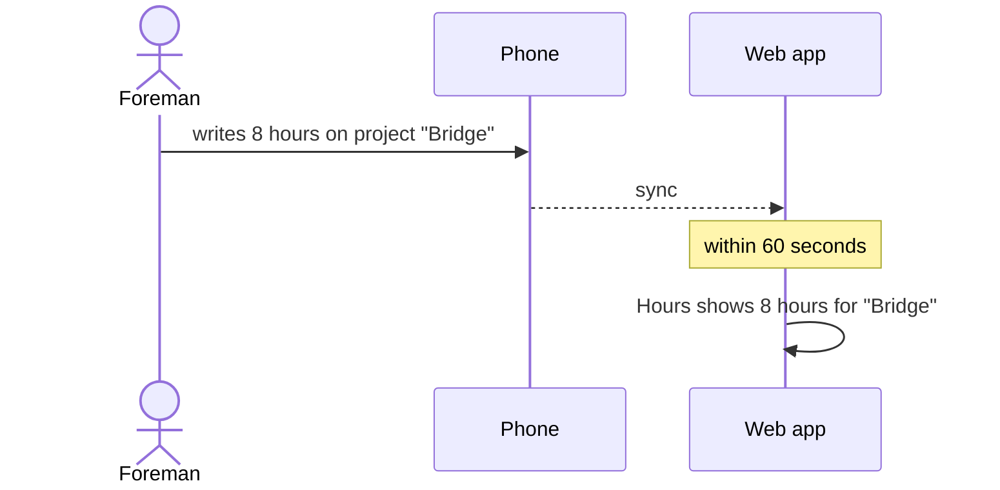

# P7 Sequence diagram: automation

The style: [../300-Pictures.md](../300-Pictures.md#p7-sequence-diagram). Entry point **B, a scenario**, on
Bruinet's **mixed head**: the diagram's arrows become the steps of one scenario across several apps. Back to
the [readme](000-Readme.md).

## What the spec says

## What proves it, by layer

| | Unit | Integration | UI fast | UI judge |
| --- | --- | --- | --- | --- |
| The sync sends the right request, the server stores it | ✓ the request builder | **✓** stub backend or the `service` head: what was sent, what was stored | | |
| The time limit | | ✓ with a fake clock | | ✓ on real apps |
| A person on the phone, another in the office, one journey | | | ✓ mixed head with headless phone | **✓** mixed head: Android and browser |

## The simplest automation

**The diagram becomes the scenario.** Each participant is an app from the suite's `Apps` table, each actor a
user; each arrow a step, said by its sender:

| Arrow | Step | Runs on |
| --- | --- | --- |
| `Foreman->>Phone: writes 8 hours on project "Bridge"` | `When Foreman writes 8 hours on project "Bridge"` | the Foreman's phone (a callable phrase) |
| `Phone-->>Office: sync` (dashed: the system, not a person) | `And the phone syncs` | the phone (a phrase, or a wait for the sync request) |
| `Note: within 60 seconds` | The next step's wait limit | — |
| `Office->>Office: Hours shows 8 hours for "Bridge"` | `Then the office's Hours shows 8 hours for "Bridge" within 60 seconds` | the web app |

Bruinet runs such scenarios today: the `Apps` table, `{user}` steps that pick their app (AD-015), and Todo's
`Mixed.Uat`, which drives Windows, web and Android in one scenario. What is new is only the **reading**:
Lirenet turns the diagram into the scenario's steps, so the diagram is not written again as Gherkin.

**Below the UI first.** The same diagram, run on the `service` head against a stub backend, checks the
request the phone sends and what the office's API then returns, in milliseconds. The mixed-head run on real
apps is the judge, at the gate.

## What it needs

| Need | Exists? |
| --- | --- |
| Several apps and users in one scenario | ✓ mixed head, `Apps` table, `{user}` phrases |
| A wait with a stated limit on a step | ✓ waits for state; **new**: "within N seconds" as a phrase suffix |
| Reading `sequenceDiagram` into steps | **New**, small; arrows → steps by the sender's name |

## Questions

- Arrow text must then bind as a phrase. Is that too strict for a diagram a person reads? Proposal: yes,
  binds or fails the check, as spec examples do today; `bruinet data validate` lists what does not bind.
- Return arrows (`-->>`) that only show an answer: steps or not? Proposal: only when the next arrow depends on
  them; otherwise they are for the reader and skipped, with Lirenet saying so.
