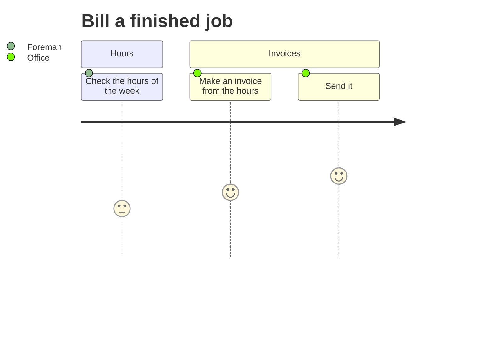

# P8 Journey map: automation

The style: [../300-Pictures.md](../300-Pictures.md#p8-journey-map). **No tests**: a journey map is an
overview for the owner, too coarse to be false. What is automated is that it stays tied to the journeys
that prove each stage. Back to the [readme](000-Readme.md).

## What the spec says

## What is automated

| Check | How | Exists? |
| --- | --- | --- |
| Every task of the map points to a journey spec that covers it | A link per task, or a table under the map: task → journey id; Lirenet checks the ids exist | **New**, small |
| Every actor is a role of the product | The product's roles (`product.md`), mapped to accounts by the suite | **New**, small |
| The map's state | Lirenet's trace, per task: the state of the journeys it points to (all passing, some failing, not reached) | **New**, from the existing trace |
| The scores (3, 4, 5) | Nothing: they are the owner's judgement of how the step feels | — |

So the map becomes a **live overview**: each stage coloured by whether its journeys are proven, which is
what the owner reads it for.

## Optional: an end-to-end scenario

If the owner wants the whole journey run once, end to end: a scenario whose steps are the map's tasks in
order, each a callable phrase that runs that journey's main example. That is a mixed-head scenario like
P7's, and expensive; one per product at most, at the gate.

## Questions

- Links in the map, or a table under it? Proposal: a table under it; Mermaid's journey syntax has no links.
- Is the map worth a document per product? Proposal: one per product, in `product.md`, not per journey.
