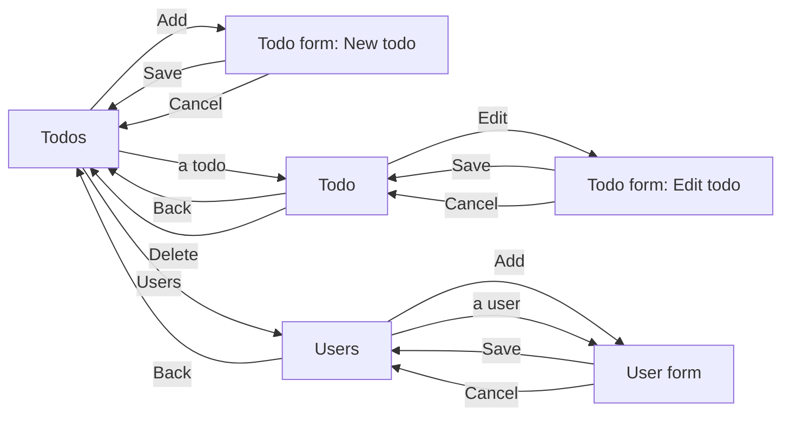

# Todo: the ways between the screens

| Field | Value |
| --- | --- |
| Product | Todo |
| Where | The app on Windows and Android. On the web: all but Users and User form |
| Status | draft |

Nodes are screens, arrows are what a person taps. What happens on a screen before it lets go (a
refused Save, the question on Cancel) is in that screen's journeys, not here.

The app opens on Todos.
