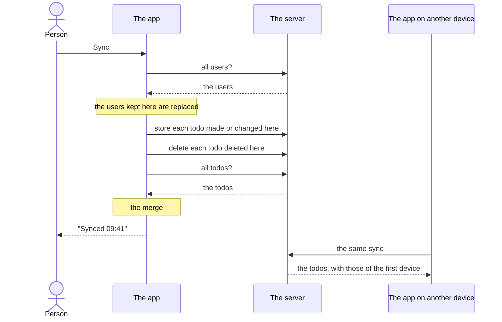

# Todo: a sync

| Field | Value |
| --- | --- |
| Product | Todo |
| Where | The app on Windows and Android, and the same app on the web; the server |
| Used by | TOD.06, TOD.07, TOD.08, TOD.11 |
| Status | draft |

## The order

A sync starts from Sync on Todos, from Retry, and once when the app opens with a connection.

- One sync at a time: a second waits for the first.
- A sync stops at the first call that fails. What the server did not confirm stays as it was, so
  the next sync sends it again.
- The users kept on the device are replaced only when the whole list has arrived. A failure there
  stops the sync before any todo is sent.
- Every call carries the app's key in "X-Api-Key". An app that was given a name carries it in
  "X-Todo-Client", and the server records which client sent each call.

## What is sent

By the todo's [sync state](todo.md) on this device.

| # | Todo here | Sent to the server | Here, after it is confirmed |
| --- | --- | --- | --- |
| 1 | Local only or Waiting, not deleted | Store it | Synced, as the server kept it |
| 2 | Synced | Nothing | Unchanged |
| 3 | Deleted, was Local only | Nothing | Gone for good |
| 4 | Deleted, was Synced or Waiting | Delete it | Gone for good |

A todo changed again while its call was out stays Waiting, with the newer change.

## The merge

What the server's list changes on this device, after the sending.

| # | Todo here | On the server | Here, after the merge |
| --- | --- | --- | --- |
| 1 | Not here | There | Stored, Synced |
| 2 | Synced | There, the same | Unchanged |
| 3 | Synced | There, different | The server's version |
| 4 | Local only or Waiting | There, changed later than here | The server's version, Synced |
| 5 | Local only or Waiting | There, changed earlier than here or at the same moment | This device's version, still waiting |
| 6 | Synced | Not there | Removed here: it was deleted elsewhere |
| 7 | Local only or Waiting | Not there | Kept |
| 8 | Deleted here | There | Left alone; the next sync deletes it on the server |

"Changed later" compares the moment each side last saved the todo.

## When a sync fails

| # | What happened | Sync line | Todos shows | Changes not yet sent |
| --- | --- | --- | --- | --- |
| 1 | No connection | Offline | The rows, as they are; Sync is disabled | Stay waiting |
| 2 | The server could not be reached | Server unreachable | The rows, as they are | Stay waiting |
| 3 | The server did not answer in time | Sync timed out | The rows, as they are | Stay waiting |
| 4 | The server refused the app's key | Not authorised | "The server refused the app's key. Check the API key and try again." and Retry | Stay waiting |
| 5 | The server had a problem | Sync failed | "The server had a problem. Try again." and Retry | Stay waiting |

Nothing kept on the device is lost by a failed sync.
