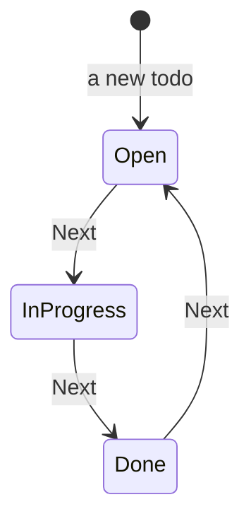
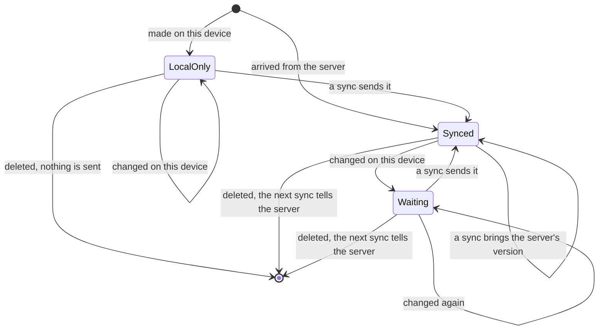

# Todo: a todo's status and sync state

| Field | Value |
| --- | --- |
| Product | Todo |
| Where | The app on Windows and Android, and the same app on the web |
| Used by | TOD.01, TOD.02, TOD.03, TOD.04, TOD.05, TOD.06, TOD.07 |
| Status | draft |

## Status

A todo has one of three statuses. Next is the only way to change it.

| Status | Mark | Name shown |
| --- | :---: | --- |
| Open | ○ | Open |
| In progress | ◐ | In progress |
| Done | ● | Done |
| (overdue) | ⚠ | Overdue |

Overdue is not a status. It is what the status shows for a todo that is late; the status kept
does not change, and Next moves on from the status kept.

## Overdue

What the status shows, by the status kept and the due date. A dash is any.

| # | Status kept | Due date | Shows |
| --- | --- | --- | --- |
| 1 | Open | before today | Overdue |
| 2 | Open | today | Open |
| 3 | Open | after today | Open |
| 4 | Open | none | Open |
| 5 | In progress | before today | Overdue |
| 6 | In progress | today, later or none | In progress |
| 7 | Done | — | Done |

Today is the day on the device.

## Sync state

Where a todo stands against the server. Todo's Sync section shows it; a row on Todos shows the
marker for every state but Synced.

| State | Shown on Todo | Marker on the row |
| --- | --- | :---: |
| LocalOnly | Local only | ☑ |
| Waiting | Waiting to sync | ☑ |
| Synced | Synced | ☐ |

A change is a saved edit or a Next on Todo. A deleted todo is gone from every screen at once; what
the sync does with it is in [sync](sync.md).
