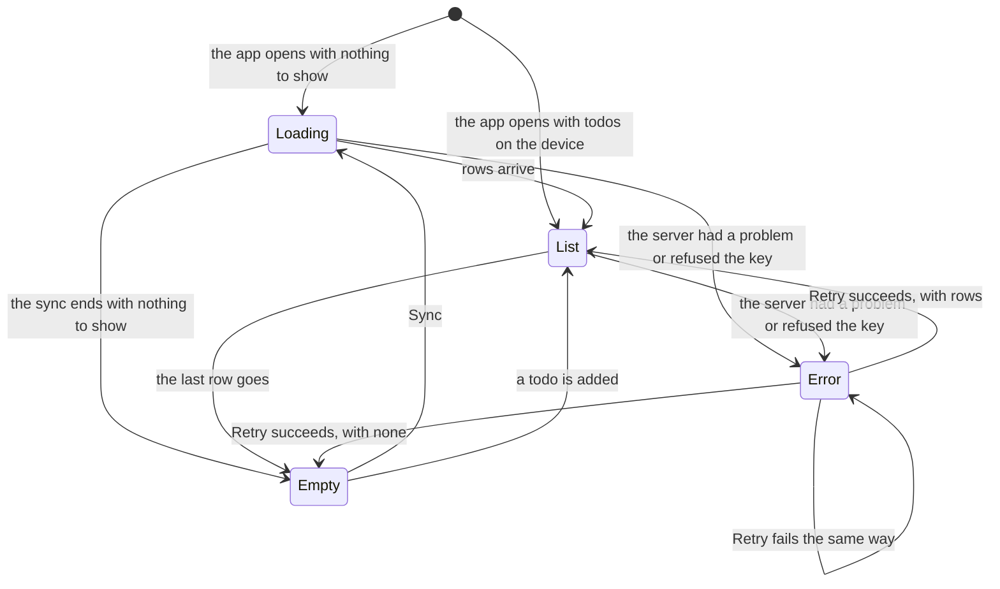

# Screen: Todos

| Field | Value |
| --- | --- |
| Product | Todo |
| Where | The app on Windows and Android, and the same app on the web |
| Used by | TOD.01, TOD.03, TOD.05, TOD.07, TOD.08, TOD.09 |
| Status | draft |

## Card

| Todos | |
| --- | --- |
| Reached by | Opening the app; Back or Delete on Todo; Save or Cancel on a new todo's form; Back on Users |
| Title | "Todos" |
| Top buttons | Sync · Add · Users |
| Above the list | Show, a choice of All · Open · In progress · Done; the sync line |
| Body | One of: the list, "Loading…", "Nothing to do", or a message with Retry |

Sync is disabled without a connection. Add and Users are always there. The sync line's texts are
in the [messages](../app/messages.md).

## The list

| Column | Shows | Sort | Filter |
| --- | --- | :---: | :---: |
| Title | The todo's title | ☑ third, A→Z, capitals ignored | ☐ |
| Due | "Due" and the day in the device's short form; nothing with no due date | ☑ second, earliest first, no due date last | ☐ |
| Status | The status's mark and name, or "Overdue"; no Next button | ☑ first, Done last | ☑ by Show |
| Marker | ● when the todo is not synced: Local only or Waiting to sync | ☐ | ☐ |

- The order is fixed; a person cannot change it.
- Show filters by the status kept, so an overdue todo that is Open shows under Open.
- A deleted todo is not listed.
- Tapping a row opens Todo.
- All todos are on one page.

## What the body shows

A dash is any.

| # | Last sync | Rows to show | A sync is running | Shows |
| --- | --- | --- | :---: | --- |
| 1 | The server had a problem, or refused the app's key | — | — | The message and Retry |
| 2 | Anything else | One or more | — | The list |
| 3 | Anything else | None | ☑ | "Loading…" |
| 4 | Anything else | None | ☐ | "Nothing to do" |

A sync that runs while rows are shown keeps them on the screen. A server that cannot be reached, or
does not answer in time, is not an Error: the rows stay and the sync line says why.
