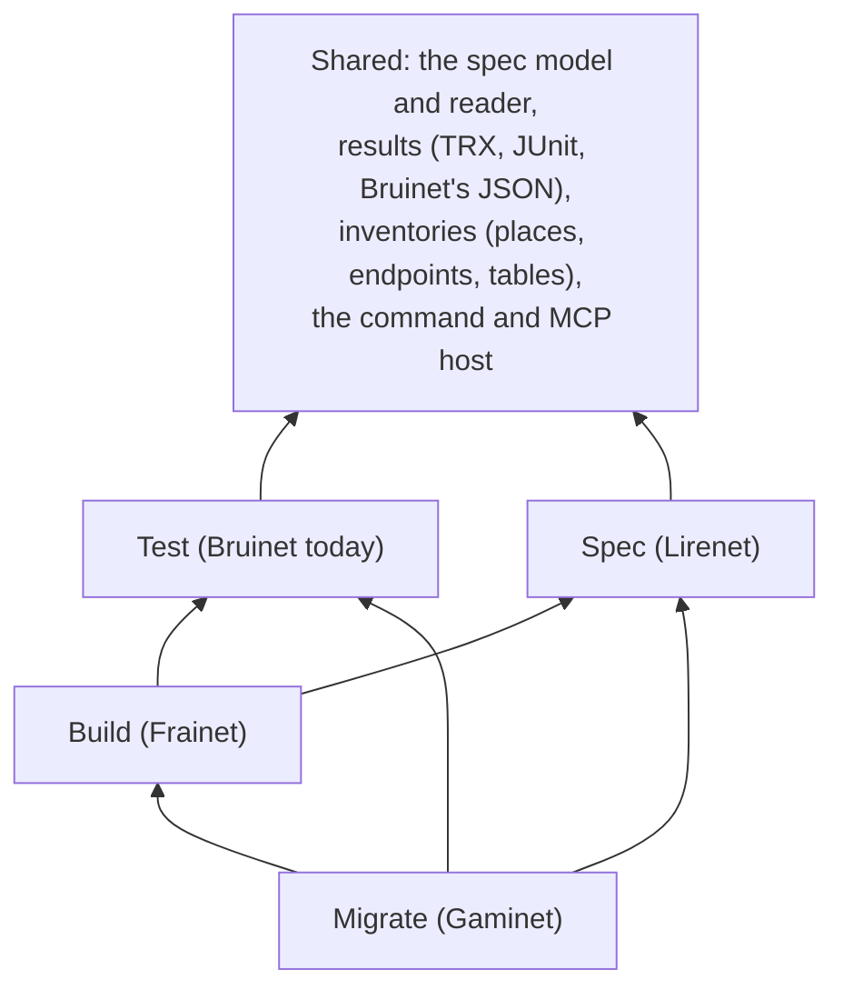

# One product or four?

Status: **decided** 2026-11-18: one product, **Bruinet**, with the modules **Test, Spec, Develop and Migrate**
(section 5). The steps are in [plan.md](plan.md). Date: 2026-11-18. Follows [what-goes-where](../parts/what-goes-where.md),
which says what each part holds. This document asks how the parts are packaged: four separate products, one
product in modules, or simply Bruinet.

## 1. The facts that decide it

| # | Fact | What it rules out |
| --- | --- | --- |
| F1 | **All parts depend on each other.** Lirenet's trace reads Bruinet's results; Bruinet runs Lirenet's specs; Frainet drives both; Gaminet uses all three | Parts that meet only through files and commands. That rule was in [what-goes-where](../parts/what-goes-where.md); it does not survive this |
| F2 | **No duplicated code.** | Two readers of one format, two result readers, a CLI per part that forwards to another |
| F3 | **There may be different user groups**: testers, developers writing specs, a team running a migration | One undivided blob that a spec user must take whole |
| F4 | **Only Bruinet is used and built out**: 46 projects under `src/`, a release, Bouw7 | Spending on separation now; it has no user to pay it back |
| F5 | **The others are mostly empty**: Lirenet about 870 lines in two projects, Frainet a 79-line forwarder, Gaminet 23 lines | Treating them as products today. They are reserved places |

F1 and F2 are the strong ones. Four products that depend on each other and share code are one product with
four release trains: all the cost of a split and none of the independence.

## 2. What the current split already costs

The rule "no project reference crosses a tool's folder" is in force today, and it already produces what F2
forbids:

| Where | What | Because of the split |
| --- | --- | --- |
| `src/Bruinet.Bdd/BddSpecReader.cs` (191 lines) and `Lirenet/src/Lirenet.Specs/SpecCheck.cs` (496 lines) | **Two readers of the spec format** | Bruinet may not reference Lirenet |
| `Frainet/src/Frainet.Cli/Program.cs` | Finds `lirenet` on disk and starts it as a process to forward `check` and `trace` | Frainet may not reference Lirenet |
| `Lirenet/src/Lirenet.Specs/RuleResults.cs` (TRX) beside Bruinet's own result JSON | Two result models | No shared place for results |
| `bruinet`, `lirenet`, `frainet`, `gaminet` | Four command hosts, four argument parsers; only `bruinet` has an MCP server | A host per part |
| Four `Directory.Build.props`, `Directory.Packages.props`, `global.json` | Four build setups to keep in step | A folder per part, each standalone |

None of it is big yet, which is the point: it is cheap to undo now.

## 3. "Depend on each other" without a cycle

Products may depend on each other both ways. Code cannot: .NET projects must form a graph without cycles. The
way to have both is to put **what the parts share at the bottom**, and the parts above it:

- Test and Spec both use the same spec reader and result model; neither references the other. Bruinet runs a
  spec through the shared reader; Lirenet traces Bruinet's results through the shared result model.
- Build and Migrate sit on top and may reference anything below.
- An architecture test keeps the arrows pointing one way.

That meets F1 and F2 at once, and it only works well in **one solution**: a change to the shared layer and to
its users is one commit, built and tested together.

## 4. The three options, measured against the facts

### Option 1: four separate products

Four names, repositories, releases, hosts.

- **For**: each user group gets a product of its own (F3); each moves at its own pace; an agent loads only one
  part's skills and tools.
- **Against**: F1 and F2 make it a version matrix (which Lirenet with which Bruinet), a shared library that
  must be released before anything above it can change, and a pull request per repository for every change
  across parts. F4 and F5: all that cost for three parts with no users.
- **Verdict**: not now. It is the right shape only when parts stop depending on each other, which F1 says they
  will not.

### Option 2: one product, in modules

One repository, one solution, one version, one release; modules for test, spec, build, migrate on top of a
shared layer (section 3).

- **For**: meets F1 and F2 directly: references where they are needed, one reader, one result model, one host.
  One CI and release, which is what F4 can afford. User groups (F3) are served by **packages and entry points**,
  not by products: a spec user takes the spec package and the spec commands, and never sees a driver.
- **Against**: one version for parts of unequal maturity, so a spec-format change bumps everything. Boundaries
  hold only by an architecture test. Under one name the spec module may look like part of a UI test tool to
  a developer (section 6).
- **Verdict**: fits.

### Option 3: simply Bruinet

Everything in Bruinet, no modules: specs, loop and migration are features of the test tool, placed where they
fit.

- **For**: cheapest; no names, no layering to keep. Fine for F4 and F5 today.
- **Against**: F3. A spec user must take the test tool whole, and the day a group wants one part, the code has
  to be untangled first. Nothing keeps the loop from growing its own checks (the verdict rule of
  [what-goes-where](../parts/what-goes-where.md)).
- **Verdict**: close to option 2, minus the seams that make F3 possible later. The seams cost little: a
  folder per module and one architecture test.

| | 1. Four products | 2. One, in modules | 3. Simply Bruinet |
| --- | --- | --- | --- |
| F1 Parts depend on each other | ○○○ through releases | ●●● references | ●●● |
| F2 No duplicated code | ●○○ needs a released shared library | ●●● | ●●● |
| F3 Different user groups | ●●● | ●●○ by package and entry point | ○○○ |
| F4 Cost now, for one used part | ○○○ | ●●○ | ●●● |
| F5 Room for the empty parts | ●●○ | ●●● a folder each | ●○○ no place for them |
| Split later, if a group needs it | n/a | ●●○ the seams exist | ○○○ untangle first |

## 5. Recommendation: one product, in modules

**Option 2.** One repository, one solution, one version, one release, one command host and MCP server. Modules
on a shared layer, the arrows kept one way by a test.

| Axis | Choice |
| --- | --- |
| Repository and solution | One: `Bruinet.sln` holds every module, including today's `Lirenet/`, `Frainet/`, `Gaminet/` projects |
| Build setup | One `Directory.Build.props`, `Directory.Packages.props`, `global.json` at the root; the per-part copies go |
| Version and release | One version, one GitHub release for every package |
| Code | Shared layer at the bottom; modules reference what they need below them; an architecture test fails on an arrow the wrong way |
| Packages | Per module, so a group takes only its part: the spec package needs nothing from the drivers |
| Commands and MCP | One host. Command groups per module (`… spec check`, `… spec trace`); MCP tools in groups an agent can load alone, so agents still see only the part they work on |
| Skills | One skills folder, a prefix or subfolder per module |
| Empty modules | Frainet and Gaminet stay folders with a README and a plan; **no code until a case needs it** (small-steps P5). Their CLIs go; Frainet's forwarder goes now |

### The names: decided

**One name, Bruinet**, and the modules **Test, Spec, Develop and Migrate**. Lirenet, Frainet and Gaminet go.

| Module | Was | Packages | Commands |
| --- | --- | --- | --- |
| Test | Bruinet | as now: `Bruinet.Core`, `Bruinet.Html`, … | as now: `bruinet scrape`, `bruinet suite`, … |
| Spec | Lirenet | `Bruinet.Spec.Format`, `Bruinet.Spec`, later `Bruinet.Spec.Xunit` | `bruinet spec check`, `bruinet spec trace` |
| Develop | Frainet | none until a case needs code; then `Bruinet.Develop` | later `bruinet develop …` |
| Migrate | Gaminet | none until a migration; then `Bruinet.Migrate` | later `bruinet migrate …` |

The risk named above stays: a developer who wants only specs may read "Bruinet" as a UI test tool. The answer
is the package (`Bruinet.Spec` needs no driver) and the root README, which names the four modules first.

### When a module becomes its own product

Only on evidence, any one of:

1. A user group uses it without the others, and the shared version hurts them.
2. Its release pace really differs: its releases hold up, or are forced by, the rest.
3. It needs other access or another licence.

Then the shared layer becomes a package of its own first, and the module moves out on top of it. The layering
of section 3 is what makes that move possible; without it, option 2 decays into option 3.

## 6. Steps, smallest first

Worked out, with checks and order, in [plan.md](plan.md). In short:

Each step is worth having alone, and each is checked by the same tests passing identically (a mechanical
change):

1. **Write down the arrows**: the architecture test from section 3, failing on any reference the wrong way.
   Planted fault: add one, see it red (small-steps P3).
2. **One build setup**: drop the per-part `Directory.*.props` and `global.json`; add the Lirenet projects to
   `Bruinet.sln`.
3. **One spec reader**: move the reading half of `SpecCheck.cs` into the shared layer; `BddSpecReader` and
   `lirenet check` both use it. Bouw7's 30 specs read the same before and after.
4. **One result model**: TRX and Bruinet's JSON read in the shared layer.
5. **One host**: `spec check` and `spec trace` as command groups of the one CLI and MCP server; drop Frainet's
   forwarder and the Frainet and Gaminet CLIs.
6. **One README at the root** naming the modules, a line each, and which package each user group takes.

Nothing here builds Frainet or Gaminet. They get code when a case in the small-steps proposal needs it.

## 7. Questions

| # | Question | Proposal |
| --- | --- | --- |
| Q1 | One product in modules? | **Decided**: yes (section 5) |
| Q2 | What goes in the shared layer? | Only what two modules both use today: the spec reader, the result model, the command host. Inventories when the Scraper writes one and Lirenet reads it |
| Q3 | Module names: `Bruinet.Spec` or `Lirenet`? | **Decided**: one name, Bruinet; modules Test, Spec, Develop, Migrate |
| Q4 | One command or a command per module? | One host with groups; aliases per user group later if asked |
| Q5 | Do Frainet and Gaminet keep a CLI while empty? | No: a folder, a README, the plan |
| Q6 | Does this replace "through files and commands, never code" in what-goes-where? | Yes, for the parts in this repository; files stay the way to reach tools outside it (Wireframe, a CI system) |
| Q7 | Must the spec package be usable with no Bruinet driver installed? | Yes: that is how F3 is served without separate products, and the architecture test checks it |
